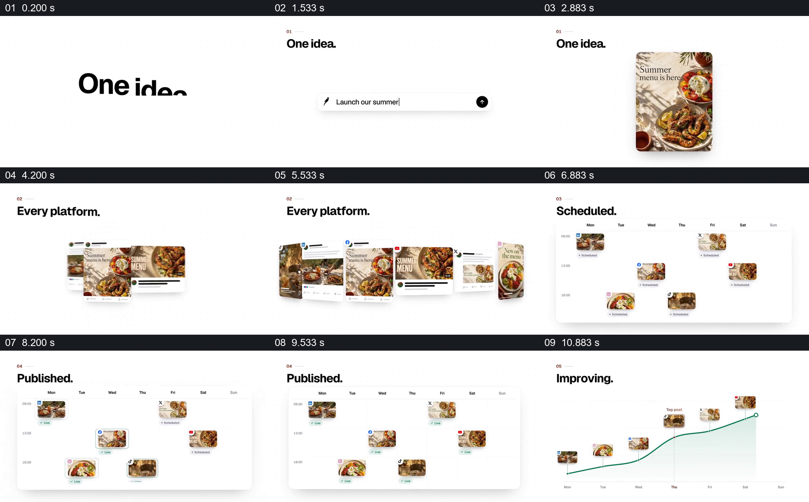

# 让同一食物创意走过平台、排期和结果

- 作品：案例 024《一条创意的跨平台发布》（索引名称）。
- 原片范围：00:00.000–00:12.000，含起点、不含终点；[完整原片](../video.mp4)｜[本卡片段](c01.mp4)。
- 观察方式：依据整片 64 宫格和约每秒一次的真实源帧观察，未连续原速观看或听审；声音、语气与完整播放节奏未确认。

## 原画面具体怎样设计

白底出现“One idea.”和输入框，接着生成一张夏季菜单图片。“Every platform.”下，同一餐食影像扩展成多种社交页面样式；这些小图进入按日期排列的日历，标题由“Scheduled.”转为“Published.”。最后图片沿时间轴排列，绿色曲线向右上升。

## 为什么这样设计，好在哪里

重复使用相同餐食图，使不同版式和日历条目仍能被识别为同一创意的后续；曲线接在发布之后，给流程一个结果展示的位置。画面没有提供曲线数据来源，不能证明发布带来增长。

以上为依据画面的分析，非作者自述；预期观看效果未经观众测试。

## 可直接使用的创意指令

当展示一个创意在多个渠道的实际传播过程时，选定可识别的核心材料，按各渠道的真实尺寸和内容要求制作对应版本；把这些版本放入带日期的排期，再显示实际发布状态。若呈现结果曲线，注明指标、时间和来源，避免将示意趋势写成已验证因果。
