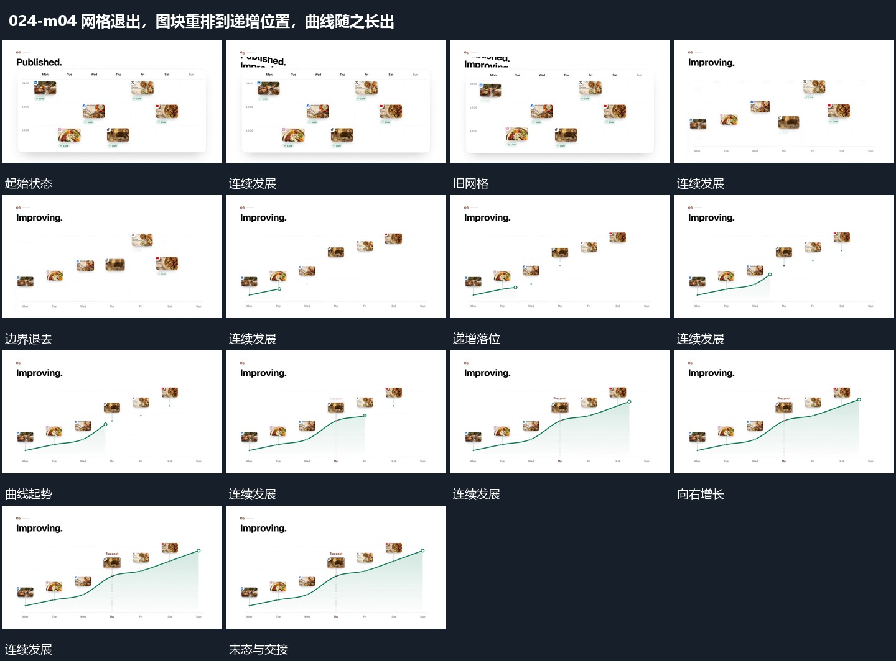

# 网格退出，图块重排到递增位置，曲线随之长出

## 运动指令

先退去网格边界，把同组图块移到由低到高的位置。图块稳定后从左端延长曲线，经过各位置时保留旧路径，下方填充同步铺开，末端落稳。

## 视频切片

[播放本机制的原片切片](m04.mp4)

保留起始准备、连续发展和完成或明确交接；首尾按本段运动范围裁切，不拼接、不变速。尾部只保留理解结果所需的展示。

## 分镜过程

## 组合与调整

图块位置与数值含义在新片另定；不能无来源地再画一组相似图块替代重排。
