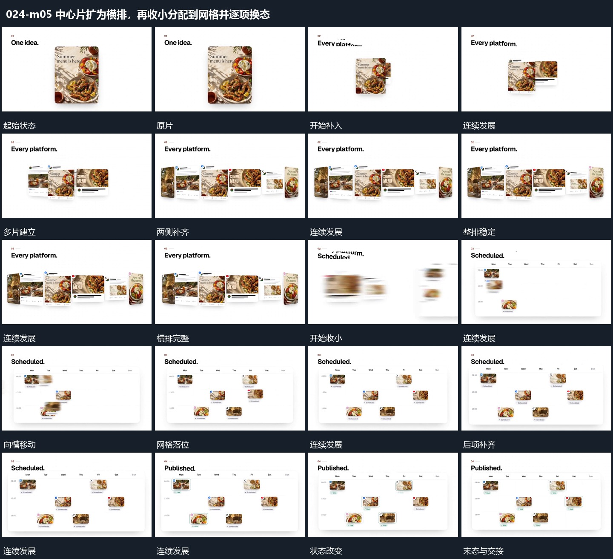

# 中心片扩为横排，再收小分配到网格并逐项换态

## 运动指令

中心片作为锚点，左右补片形成横排；整个集合收小重排进入网格，内部状态逐项更新后保持。

1. **保留中心片，左右错开补入后片**

保留中心片，在左右两侧错开补入大小不同的片面，形成横向集合。先到者保持，后片在剩余空位建立，不把中心片重播入场。

2. **横排收小并分配到网格空位，局部状态逐项更新**

把横排各片缩小并分别移向网格的空位，边界建立后各片落稳。之后按项更新内部小标记，先完成者保持，网格不随更新移动。

整段结束：图块落入不同格位，内部标记依次改变 保留必要落稳与交接，中间已建立的参照沿用到下一步骤。

## 视频切片

[播放本机制的原片切片](m05.mp4)

保留起始准备、连续发展和完成或明确交接；首尾按本段运动范围裁切，不拼接、不变速。相连的小动作合为同一完整段落。

## 分镜过程

## 组合与调整

中心片作为锚点，左右补片形成横排；整个集合收小重排进入网格，内部状态逐项更新后保持。 复用时可调整元素数量、幅度和相对节奏，保留上述进入、交叠与完成关系；不直接沿用原片题材或时长。

可以减少数量，保留单项成为集合一员的关系。

路径需让来源与目标可追踪，先定槽位再定运动幅度。
