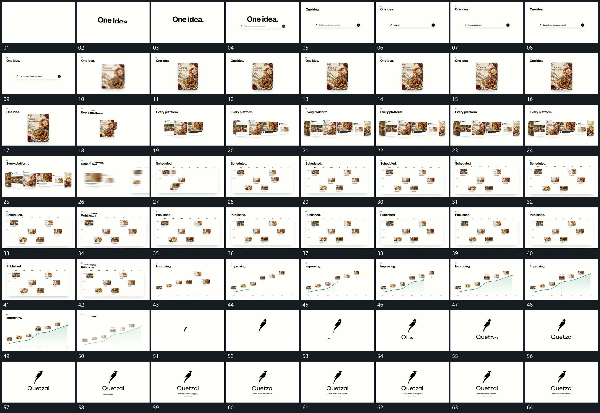

# 024｜原片运动总览

[观看完整原片](video.mp4)

## 运动总览

开头大字建立后上移缩小，主字上移缩小，输入条逐字补齐后交给竖片 在下方输入条逐字补齐，再将内容接给独立竖片。随后 保留中心片，左右错开补入后片 保留这张片作为中心，左右补入不同大小的片面，组成一排。

中段 横排收小并分配到网格空位，局部状态逐项更新 把横排收小并分配到固定网格的不同空位，格内状态逐项更新。后段 网格退出，图块重排到递增位置，曲线随之长出 退去网格边界，图块重排到递增位置，折线和填充从左到右生长，已放好的图块保持。末尾图表退去，标记与名称逐段建立。

## 完整运动段落

以下按原片中的出现顺序引用。建立、内部发展及完成反馈放在同一段中；同时发生的局部动作与运镜写在同一份指令里。不同段之间可以是连续接管，也可以是直接切换，不能仅凭条目相邻认定可直接拼接。重复出现的同类运动采用一次连续代表范围，切片不以逐段无缝覆盖整片为目标。

1. [主字上移缩小，输入条逐字补齐后交给竖片](mechanisms/m01.md)：标题让出下方空间，输入与结果接力

2. [中心片扩为横排，再收小分配到网格并逐项换态](mechanisms/m05.md)：中心片作为锚点，左右补片形成横排；整个集合收小重排进入网格，内部状态逐项更新后保持。

3. [网格退出，图块重排到递增位置，曲线随之长出](mechanisms/m04.md)：保留图块身份，撤掉容器后重新落位

切片保留起始准备、必要内部停顿和完成或明确交接；首尾省略无新发展的等待，持续运动不要求人为停住。以上基于真实源帧序列和重点边界核对，不等同于全片连续声画审片。

## 完整64宫格

