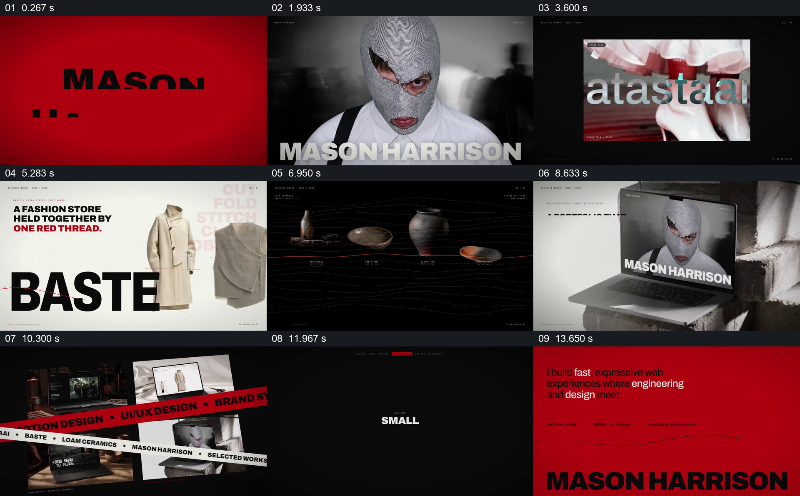

# 让不同作品先独立建立，再由字带接成同一个作品集

- 作品：案例 016《服饰、建筑与品牌排版》（库内索引名）。
- 原片范围：00:00.000–00:15.061，含起点、不含终点；[完整原片](../video.mp4)｜[本卡片段](../video.mp4)，片段起点对应原片 0.000 秒。
- 范围依据：从作者身份建立，到各项目、并列集合与作者声明共同形成一段完整作品集。
- 观察方式：核看全片 64 帧总览及本卡九宫格；未独立连续原速观看，快速变化和运动节奏待核。未独立听审，声音内容未知。片中事实和演示未独立查证，新题材迁移尚未实测。

## 原画面具体怎样设计

开场红底上出现黑色姓名“MASON HARRISON”，随后黑白人物近景占满画面，姓名变为底部白色大字。画面进入黑色作品展示空间：先出现品牌影片小窗，再是笔记本电脑与项目文案；白底服装页面以巨大“BASTE”、两件衣服和一条红线组成另一幅构图；黑底陶器与细线、陶器项目电脑页随后依次出现。后面一台电脑屏幕重新显示开场人物及姓名，使作者身份回到作品集合。

约 00:10，四个项目画面缩成深色背景上的集合，红色字带横跨前景，白色字带以不同方向交叉；底层四个窗口仍各自保留。随后大词“DESIGN”“CODE”“MOTION”“SMALL”“DETAILS”等先后单独占据黑、白、红画面，最后回到红底姓名与简短作者声明。

## 为什么这样设计，好在哪里

项目各自保留素材与页面外观，统一的是外层的红黑白、粗字和作者身份；这样观众既能辨认具体作品，又能知道它们属于同一个作品集。红白字带横过四个窗口时没有把底层集合一起替换，正因为四个项目仍能同时看见，前景的专业类别与后景的实际作品才形成对应。若直接轮播风格词或只留四张缩略图，会分别失去作品依据或统一身份。

## 可直接使用的创意指令

为同一作者或团队准备数个真实作品，每项保留能辨认其独特内容的实际画面；先用共同身份建立观看对象，让项目依次呈现，再把已经出现的作品缩成同一集合。使用与内容有关的前景文字、线条或其他连接对象贯穿集合，同时保留底层各项目的独立边界；最后回到准确的作者声明。

作品数量、配色、人物形式和带状物均可改变，不能丢失独立作品、共同身份、集合与最终声明的关系。需要观众阅读细节时，应放慢展示并保留更大作品区域；项目归属与能力描述需有真实依据。
