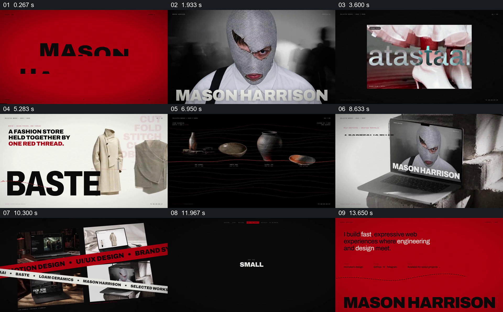

# 让不同作品先独立建立，再由字带接成同一个作品集

- 作品：案例 016《服饰、建筑与品牌排版》（库内索引名）。
- 原片范围：00:00.000–00:15.061，含起点、不含终点；[完整原片](../video.mp4)｜[本卡片段](../video.mp4)，片段起点对应原片 0.000 秒。
- 范围依据：从作者身份建立，到各项目、并列集合与作者声明共同形成一段完整作品集。
- 观察方式：核看全片 64 帧总览及本卡九宫格；未独立连续原速观看，快速变化和运动节奏待核。未独立听审，声音内容未知。片中事实和演示未独立查证，新题材迁移尚未实测。

## 原画面具体怎样设计

开场红底上出现黑色姓名“MASON HARRISON”，随后黑白人物近景占满画面，姓名变为底部白色大字。画面进入黑色作品展示空间：先出现品牌影片小窗，再是笔记本电脑与项目文案；白底服装页面以巨大“BASTE”、两件衣服和一条红线组成另一幅构图；黑底陶器与细线、陶器项目电脑页随后依次出现。后面一台电脑屏幕重新显示开场人物及姓名，使作者身份回到作品集合。

约 00:10，四个项目画面缩成深色背景上的集合，红色字带横跨前景，白色字带以不同方向交叉；底层四个窗口仍各自保留。随后大词“DESIGN”“CODE”“MOTION”“SMALL”“DETAILS”等先后单独占据黑、白、红画面，最后回到红底姓名与简短作者声明。

## 为什么这样设计，好在哪里

项目各自保留素材与页面外观，统一的是外层的红黑白、粗字和作者身份；这样观众既能辨认具体作品，又能知道它们属于同一个作品集。红白字带横过四个窗口时没有把底层集合一起替换，正因为四个项目仍能同时看见，前景的专业类别与后景的实际作品才形成对应。若直接轮播风格词或只留四张缩略图，会分别失去作品依据或统一身份。

## 完整照排指令

以[完整原片](../video.mp4)的 0–15.061 秒为准。画幅 1280×720，源帧率 60/1。以下拍点为抽帧定位，位置按画幅百分比取近似值。

### 用料

【作者姓名】【作者肖像】【项目甲展图】【项目乙展图】【项目丙展图】【作品墙组】取同一作者的真实作品，异质题材允许不同光色和画幅。另备【项目名组】【项目说明组】【作品带文字】【大字短组】【作者声明】【声明细行】。项目团队或职责若有署名，保留可打开的成品及署名资料。蒙面肖像开场与后面复现位置用同一演员和同一面具。

### 按源时刻摆放

1. **0.000–约 1.000 秒。** 深红渐变铺满，中轴粗黑【作者姓名】两行，字高明显，行距紧。转为【作者肖像】：浅面具占中部，银灰浅墙与暗肩围住脸。白色粗横【作者姓名】叠画底，近满宽。先让眼与衣料可辨，再切项目。
2. **约 3.500–8.500 秒。** 近黑版用右侧小【项目乙展图】和左侧短白【项目说明组】起拍。接暖白服装版，【项目甲展图】在右半陈列实物，黑粗【项目名组】压左下，左上小字分行并用红强调。接暗室内【项目乙展图】及右上浅字，再快速回到面具眼，裁成右或中央特写，继而给【项目丙展图】的灰调陈列和画侧短说明。白底与黑底互换，但重字与短说明保持相近视觉重量。实拍从各镜进入播到切出，服装或展台允许静照微移。
3. **约 8.500–11.500 秒。** 黑底错叠【作品墙组】，至少复用前面已辨认的作品，各自保留原有黑白反差。前层用两条跨幅斜字带，红底黑字与白底黑字交叉，填【作品带文字】。交叉带允许持续滑动，作品墙退为后层但仍可辨。随后切近黑底，以一屏一组【大字短组】快速切换，红粗字占主体；接满红底上的白大字。
4. **约 11.500–15.061 秒。** 红底复用开场色，左上区以小浅字和低亮深红行排【作者声明】【声明细行】。底端黑色超粗【作者姓名】贴近画边，近满宽，避免挤占声明阅读。至片尾切出。

### 局部采用

只有两套项目可取约 3.500–8.500 秒的单项切换，另按素材剪点调整。只用作品墙可取约 8.500–11.500 秒，但墙内需放前文可指认的同作者作品。

### 验证状态

已对照逐秒原片画序并读回，核对姓名跨红底与人物、作品间的色面切换、交叉字带及红底声明。精确切点、快字细节、原速听看及换料试摆待核。
