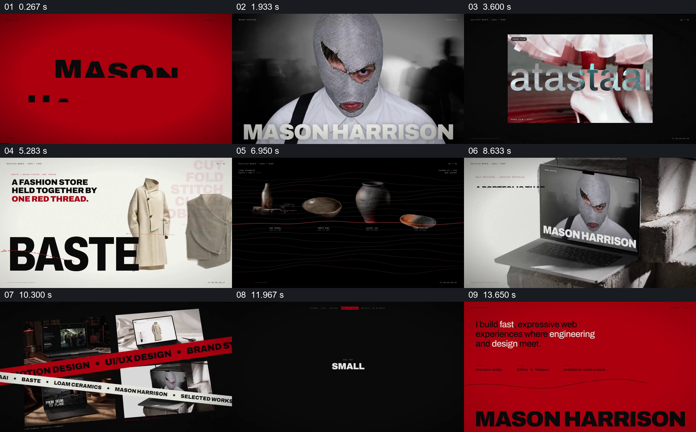

# 用共同的巨字与红线串起不同作品

- 作品：案例 016《服饰、建筑与品牌排版》（索引名称）。
- 原片范围：00:00.000–00:15.061，含起点、不含终点；[完整原片](../video.mp4)｜[本卡片段](../video.mp4)。
- 观察方式：依据整片 64 宫格和约每秒一次的真实源帧观察，未连续原速观看或听审；声音、语气与完整播放节奏未确认。

## 原画面具体怎样设计

红底上出现“MASON HARRISON”，接着是人物近景和同名巨字。画面切过电脑屏、浅色服装页面、深色器皿、电脑承载的人物页面，红色细线及大字贯穿不同画面；随后多张作品页面和红色横带同屏，巨大的“DESIGN”“DETAILS”及红底文字接回姓名收尾。各项影像的准确动作和过渡需看连续原片进一步核对。

## 为什么这样设计，好在哪里

不同作品题材和材质不断变化，但姓名、大字、红黑白和线条提供可反复辨认的共同语言；作品页集合让前面闪过的多个项目回到一个整体。短促展示强调气质和范围，不足以解释每个项目的事实与过程。

以上为依据画面的分析，非作者自述；预期观看效果未经观众测试。

## 可直接使用的创意指令

当需要把多项已有作品组织成简短作品集时，先确定能贯穿各作品的身份文字、有限色彩和排版层级；为每项作品挑选一个辨认度高的画面，在共同语言下依次展示，并让部分作品最终同屏汇合，再回到身份信息。图像、作者关系和许可须核实；若观众需要阅读项目细节，应增加停留或另设详情，不依赖快速蒙太奇。
