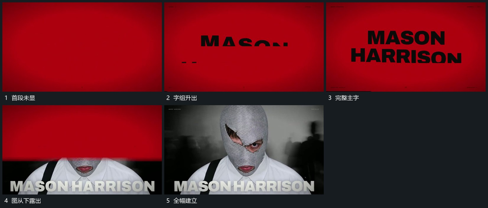

# 大字从遮挡边界升出，新图自下方揭示

## 运动指令

让大字从水平遮挡边界向上升出，落稳后新图像从下方揭出占满画面。底部大字留场，图像内部继续活动。

## 视频切片

[播放本机制的原片切片](m01.mp4)

覆盖分镜中“首段未显”至“全幅建立”的连续过程，并保留邻近的前后衔接画面；原片中交叠发生的动作一并保留。

## 分镜过程

## 组合与调整

可改边界高度，文字与图像别同时无来源地闪现。
