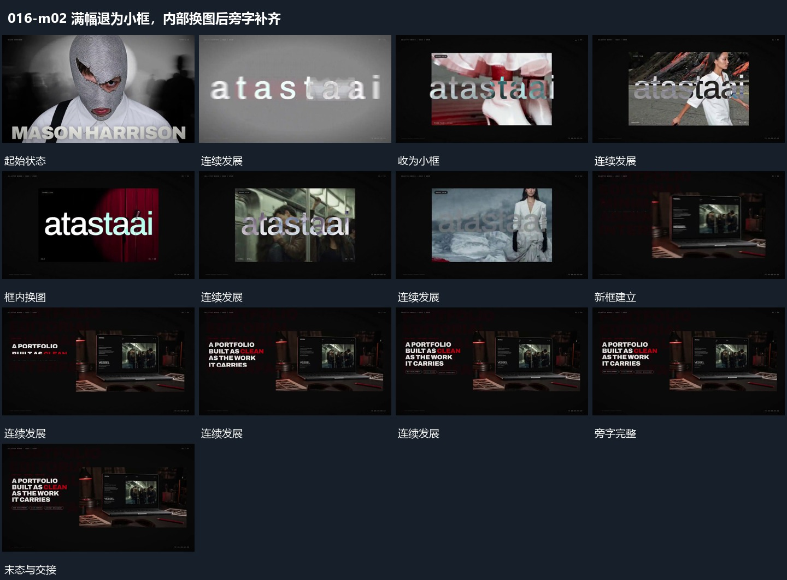

# 满幅退为小框，内部换图后旁字补齐

## 运动指令

让满幅退为独立小框，内部画面接续更换。框稳定后旁侧短字按行补入，下方小标签最后接上，框内活动不停止。

## 视频切片

[播放本机制的原片切片](m02.mp4)

保留起始准备、连续发展和完成或明确交接；首尾按本段运动范围裁切，不拼接、不变速。尾部只保留理解结果所需的展示。

## 分镜过程

## 组合与调整

如果内容不同，应明确为换图，不能冒写同一素材一直缩小。
