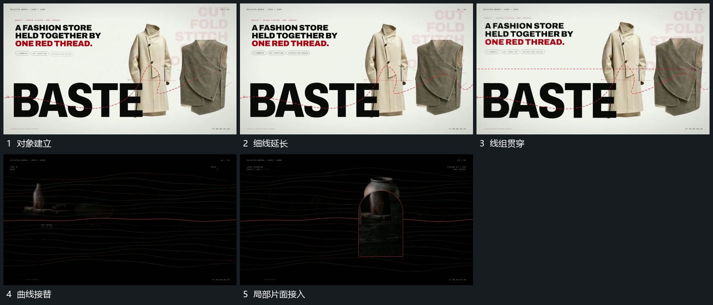

# 细线在对象前后逐段延长，曲线持续波动

## 运动指令

在稳定对象前后延长细线，让线依次穿过空位，已画过部分保留。随后多条曲线沿横向波动，局部新片面接入，前后遮挡使线并非全部在同一层。

## 视频切片

[播放本机制的原片切片](m04.mp4)

覆盖分镜中“对象建立”至“局部片面接入”的连续过程，并保留邻近的前后衔接画面；原片中交叠发生的动作一并保留。

## 分镜过程

## 组合与调整

可减少线数，保留主要对象可辨认；曲线运动不等于整幅平移。
