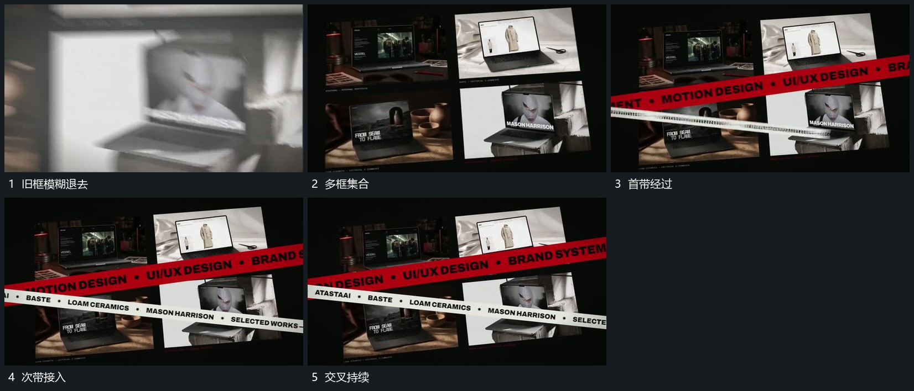

# 多片缩排成集合，交叉长带从两侧经过

## 运动指令

将多个片面缩排成集合，先保持它们的各自内容。上方长带横向经过，另一倾斜带从相反侧接入，交叉时底层集合不跟着移动，最后宽层接管换场。

## 视频切片

[播放本机制的原片切片](m05.mp4)

覆盖分镜中“旧框模糊退去”至“交叉持续”的连续过程，并保留邻近的前后衔接画面；原片中交叠发生的动作一并保留。

## 分镜过程

## 组合与调整

可改带角度，必须保持底层与带独立；带内文字另按新片内容确定。
