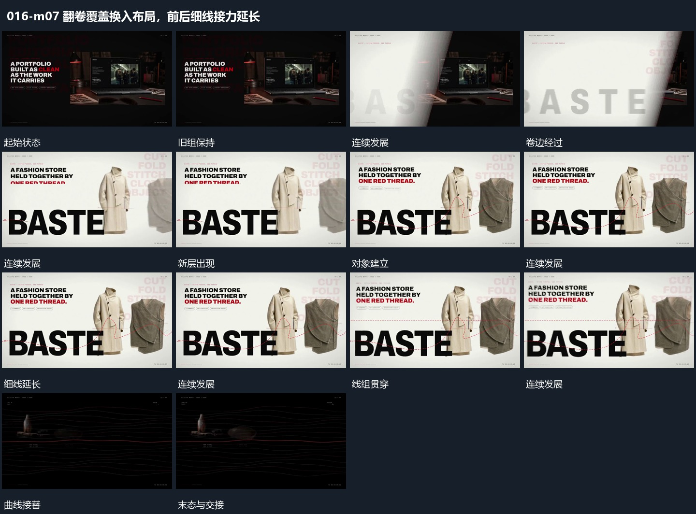

# 翻卷覆盖换入布局，前后细线接力延长

## 运动指令

覆盖层先揭出新布局，局部细线随后在前后层延长；共同保留形成完成画面。

1. **翻卷状覆盖从侧边通过，揭出下一布局**

让带翻卷状边缘的覆盖层从侧方穿过，旧组被它遮住，后缘离开时露出新布局。新组先建立主要形，再补旁字。

2. **细线在对象前后逐段延长，曲线持续波动**

在稳定对象前后延长细线，让线依次穿过空位，已画过部分保留。随后多条曲线沿横向波动，局部新片面接入，前后遮挡使线并非全部在同一层。

整段结束：线组贯穿画面，局部仍可见 保留必要落稳与交接，中间已建立的参照沿用到下一步骤。

## 视频切片

[播放本机制的原片切片](m07.mp4)

保留起始准备、连续发展和完成或明确交接；首尾按本段运动范围裁切，不拼接、不变速。相连的小动作合为同一完整段落。

## 分镜过程

## 组合与调整

覆盖层先揭出新布局，局部细线随后在前后层延长；共同保留形成完成画面。 复用时可调整元素数量、幅度和相对节奏，保留上述进入、交叠与完成关系；不直接沿用原片题材或时长。

只描述可见卷边，不推定真实布料或纸张模拟；覆盖要完整。

可减少线数，保留主要对象可辨认；曲线运动不等于整幅平移。
