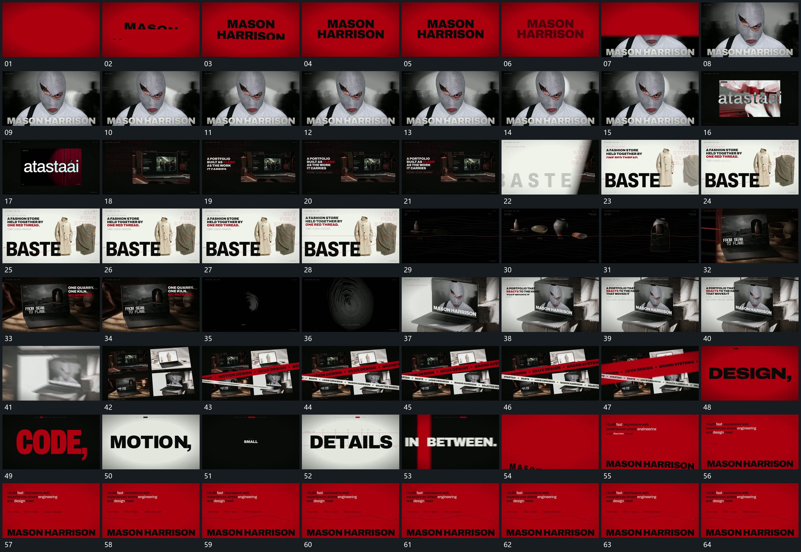

# 016｜原片运动总览

[观看完整原片](video.mp4)

## 运动总览

片头 大字从遮挡边界升出，新图自下方揭示 让大字越过遮挡边界建立，新图从下方揭出，字组留在底部。接 满幅退为小框，内部换图后旁字补齐 将图像缩为框内内容，切换内部画面后补旁侧字。随后 翻卷状覆盖从侧边通过，揭出下一布局 从侧面推进翻卷状覆盖层，换入新的并置布局。

中段 细线在对象前后逐段延长，曲线持续波动 在稳定对象前后延长细线与曲线，再换到活动框，旁字仍按分行接力。下一组由同类覆盖换场接入。后段 多片缩排成集合，交叉长带从两侧经过 让多片缩排成集合，交叉长带横向经过。末段 中央大词接续轮换，侧面片层铺满后留下收尾组 在同一中央位置接续轮换大词，新面片侧向铺满后留下上下两处文字，曲线轻摆到结尾。

## 完整运动段落

以下按原片中的出现顺序引用。建立、内部发展及完成反馈放在同一段中；同时发生的局部动作与运镜写在同一份指令里。不同段之间可以是连续接管，也可以是直接切换，不能仅凭条目相邻认定可直接拼接。重复出现的同类运动采用一次连续代表范围，切片不以逐段无缝覆盖整片为目标。

1. [大字从遮挡边界升出，新图自下方揭示](mechanisms/m01.md)：字组先落稳，图像揭出时保留底部文字

2. [满幅退为小框，内部换图后旁字补齐](mechanisms/m02.md)：边界收小后留场，内容更新与侧字建立错开

3. [翻卷覆盖换入布局，前后细线接力延长](mechanisms/m07.md)：覆盖层先揭出新布局，局部细线随后在前后层延长；共同保留形成完成画面。

4. [多片缩排成集合，交叉长带从两侧经过](mechanisms/m05.md)：集合稳定，带独立横移且不带动底层

5. [中央大词接续轮换，侧面片层铺满后留下收尾组](mechanisms/m06.md)：大词复用中部位置，侧层最后接管

切片保留起始准备、必要内部停顿和完成或明确交接；首尾省略无新发展的等待，持续运动不要求人为停住。以上基于真实源帧序列和重点边界核对，不等同于全片连续声画审片。

## 完整64宫格

