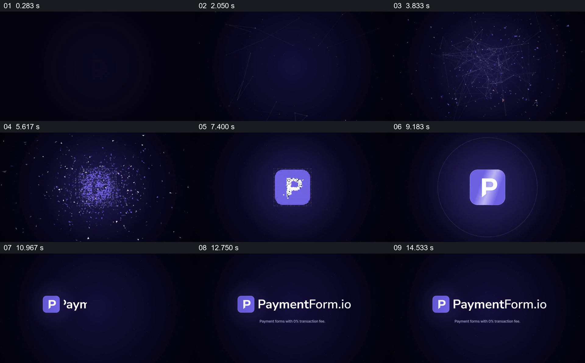

# 让散开的粒子逐步形成标志，再展开名称

- 作品：案例 113《粒子聚合为支付标志》（本次概括）。
- 原片范围：00:00.000–00:16.042，含起点、不含终点；[完整原片](../video.mp4)｜[本卡片段](../video.mp4)。
- 观察方式：依据约每秒一次的真实源帧观察，未连续原速观看或听审；声音、语气与完整播放节奏未确认。

## 原画面具体怎样设计

深紫背景里先出现稀疏线条与点，中心逐渐形成更密集的粒子团；粒子聚拢为紫色圆角方块和白色 P，图标稳定后移到左侧，右边逐渐出现 PaymentForm.io 与较小说明文字。

## 为什么这样设计，好在哪里

先只提供零散点线，再让它们汇聚成可辨图标，使观众先看到形成过程，随后用名称明确身份；最后图标和文字并列，便于阅读。具体运动与音效未连续核验。

以上为依据画面的分析，非作者自述；预期观看效果未经观众测试。

## 可直接使用的创意指令

揭示一个已有品牌标志时，从与标志颜色或形状有关的元素建立画面，让这些元素逐步汇聚到准确标志；待形态清晰稳定后再给出名称和必要说明，保留足够阅读时间。标志应使用获授权的准确版本。
