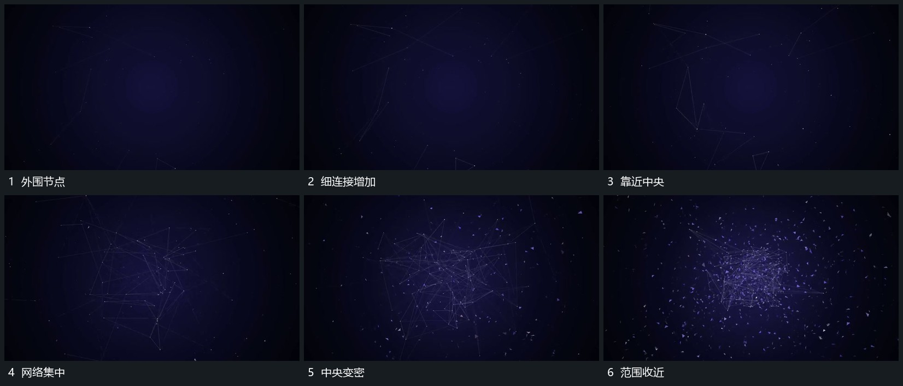

# 外围节点靠近中央连接逐步变密

## 运动指令

外围节点带细连接缓慢靠近中央，已有连接随端点移动改变角度，新的短连接在相邻点靠近时接上。中央范围逐渐变密，外围仍有少量点经过，最后把大范围收成较紧的局部。

## 视频切片

[播放本机制的原片切片](m01.mp4)

覆盖分镜中“外围节点”至“范围收近”的连续过程，并保留邻近的前后衔接画面；原片中交叠发生的动作一并保留。

## 分镜过程

## 组合与调整

保留连接的端点关系，不能把网络当静态图统一缩小；不推定原网络算法。
