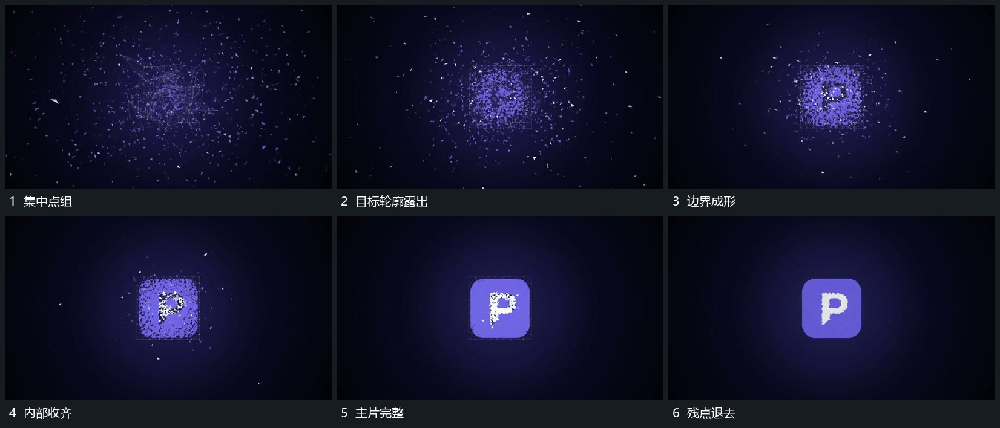

# 分散点收向目标轮廓先成边界再填齐内部

## 运动指令

让点组继续向目标位置收近，边缘点先对齐外轮廓，形成清楚主片边界。内部点随后聚成短形，剩余点向边外经过并退弱；主片位置保持，到内部完整后停止大幅变化。

## 视频切片

[播放本机制的原片切片](m02.mp4)

覆盖分镜中“集中点组”至“残点退去”的连续过程，并保留邻近的前后衔接画面；原片中交叠发生的动作一并保留。

## 分镜过程

## 组合与调整

目标轮廓由新片设计；收齐是有位置的聚合，不用完整图替换尚未成形点组。
