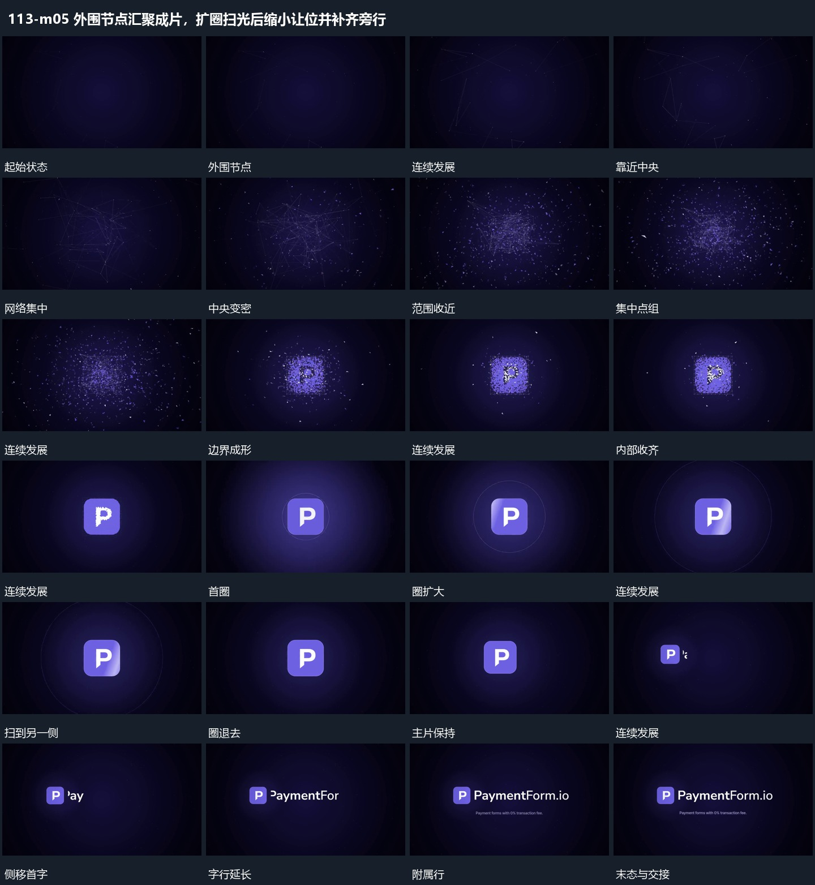

# 外围节点汇聚成片，扩圈扫光后缩小让位并补齐旁行

## 运动指令

外围节点靠近中央，连接逐渐变密；散点沿目标边缘聚拢，再填齐内部形成完整片面；圈线扩散与斜带扫过作为落定反馈，主片缩小侧移，旁行逐字补齐。

1. **外围节点靠近中央连接逐步变密**

外围节点带细连接缓慢靠近中央，已有连接随端点移动改变角度，新的短连接在相邻点靠近时接上。中央范围逐渐变密，外围仍有少量点经过，最后把大范围收成较紧的局部。

2. **分散点收向目标轮廓先成边界再填齐内部**

让点组继续向目标位置收近，边缘点先对齐外轮廓，形成清楚主片边界。内部点随后聚成短形，剩余点向边外经过并退弱；主片位置保持，到内部完整后停止大幅变化。

3. **圈线从主片附近外扩窄斜带扫过片面**

以主片附近为中心建立细圈并向外扩张，主片保持尺寸。窄斜带从片面一侧横过到另一侧，带经过后原片面仍在；细圈继续扩大并退弱，不带动主片离场。

4. **主片缩小侧移旁行逐字补齐后保持**

让主片缩小并向一侧移动，保持其内部完整。腾出的旁侧范围从首字开始逐字延长，整行完成后补下方小行；主片与两行组成共同范围，停止位移并保持。

整段结束：小主片与旁行完整 保留必要落稳与交接，中间已建立的参照沿用到下一步骤。

## 视频切片

[播放本机制的原片切片](m05.mp4)

保留起始准备、连续发展和完成或明确交接；首尾按本段运动范围裁切，不拼接、不变速。相连的小动作合为同一完整段落。

## 分镜过程

## 组合与调整

外围节点靠近中央，连接逐渐变密；散点沿目标边缘聚拢，再填齐内部形成完整片面；圈线扩散与斜带扫过作为落定反馈，主片缩小侧移，旁行逐字补齐。 复用时可调整元素数量、幅度和相对节奏，保留上述进入、交叠与完成关系；不直接沿用原片题材或时长。

保留连接的端点关系，不能把网络当静态图统一缩小；不推定原网络算法。

目标轮廓由新片设计；收齐是有位置的聚合，不用完整图替换尚未成形点组。

圈和扫带可单独采用；只保留可见经过关系，表面外观由新片决定。

可接任意稳定图形，侧移先留空再补旁行，不把文字直接盖在主片上。
