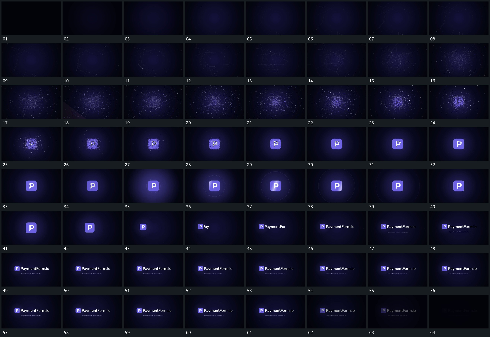

# 113｜原片运动总览

[观看完整原片](video.mp4)

## 运动总览

全片由外围节点靠近中央连接逐步变密让外围节点与细线逐步靠近中央，形成更密的局部网络。随后分散点收向目标轮廓先成边界再填齐内部把分散点继续收向目标轮廓，边界先完整，内部再逐步收齐。

主片完成后圈线从主片附近外扩窄斜带扫过片面从其附近向外扩张圈线，窄斜带沿片面扫过；圈线退去，主片缩小侧移旁行逐字补齐后保持把主片缩小侧移，旁行逐字补齐，最后稳定保持并退弱。

## 完整运动段落

以下按原片中的出现顺序引用。建立、内部发展及完成反馈放在同一段中；同时发生的局部动作与运镜写在同一份指令里。不同段之间可以是连续接管，也可以是直接切换，不能仅凭条目相邻认定可直接拼接。重复出现的同类运动采用一次连续代表范围，切片不以逐段无缝覆盖整片为目标。

1. [外围节点汇聚成片，扩圈扫光后缩小让位并补齐旁行](mechanisms/m05.md)：外围节点靠近中央，连接逐渐变密；散点沿目标边缘聚拢，再填齐内部形成完整片面；圈线扩散与斜带扫过作为落定反馈，主片缩小侧移，旁行逐字补齐。

切片保留起始准备、必要内部停顿和完成或明确交接；首尾省略无新发展的等待，持续运动不要求人为停住。以上基于真实源帧序列和重点边界核对，不等同于全片连续声画审片。

## 完整64宫格

