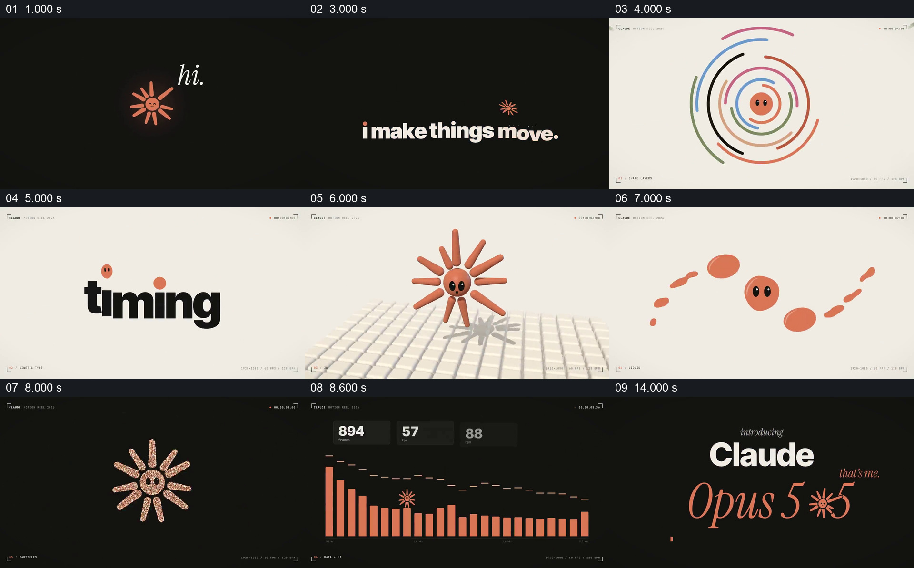
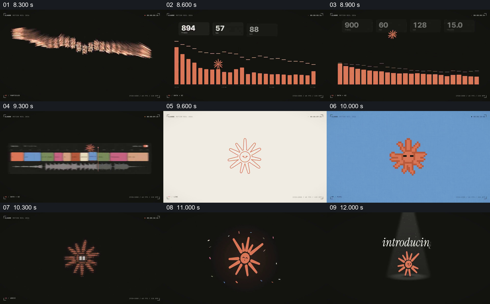

# 让同一角色穿过不同视觉实验，再揭晓身份

- 作品：案例 120。
- 原片范围：00:00.000–00:15.061（源时间，含起点、不含终点）；[完整原片](../video.mp4)｜[本卡片段](../video.mp4)。复用同范围片段和分镜。
- 观察方式与未确认范围：核看全片 64 帧总览和本卡九宫格；另核看上述补充分镜；未独立连续原速观看或听审，抽帧间运动、精确节奏及同步未确认。价值判断为作品分析，跨项目迁移尚未实测。

补充分镜源时间：8300、8600、8900、9300、9600、10000、10300、11000、12000 毫秒。

## 原画面具体怎样设计

暗底中央先出现一个橙色放射形小角色和“hi.”；角色缩在短句上方，文字逐步组成“i make things move.”。进入浅色页面后，橙色脸部与眼睛位于彩色同心线中心，随后同一脸部出现在“timing”等大字附近。

再往后，相同的脸和橙色出现在有地面阴影的立体放射体、液态形态与暗底粒子图形中。场景和材质在变，有时只保留脸部，有时恢复完整放射形轮廓；这些识别点让不同画法仍可对应到开头的角色。随后角色出现在柱状图、时间线式界面、线描、像素和字符图形里；补充分镜保留这些易在主九宫格中遗漏的状态。

角色回到暗底聚光区域，“introducing”出现在上方；最后“Claude / Opus 5.5”成为视觉中心，橙色小角色短暂出现在数字之间，旁边写“that’s me.”。末尾有制作方式小字，角色与名称共同完成自我介绍的回收。抽帧不确认各画法之间的完整变形路径。

## 为什么这样设计，好在哪里

许多作品集只是连续切换风格，这里先让观众认识一个有眼睛和放射轮廓的角色，再把它放进每种视觉实验，因此不同形式有一个能追踪的共同对象。文字、立体、粒子和界面各自给角色不同的表现环境，而不仅是排列技术名词。

结尾把角色放进名称里，并以“that’s me.”回应开头的问候，使品牌揭晓与角色演出形成一个完整结果。数据、制作方式和名称是片中展示内容，不由画面证明真实来源或产品能力；以上为作品分析。

## 可直接使用的创意指令

当介绍对象能够以多种形式出现时，先建立少量稳定识别特征，如轮廓、配色、脸部或标志，再用一句简短自我介绍让观众记住主体。挑选确有区分的图形、材质、真实素材或信息场景，让主体在每一项里承担具体角色；允许局部形态变化，但保留足够特征让它可被认出。最后把主体与正式名称或明确身份共同放入收束画面，回应最初出场。

样式数量、角色外观、空间和顺序可以重做；关键是各段共享同一可识别主体，结尾身份与开头的主体有关。涉及数据或实际能力的内容应使用可核实资料。
