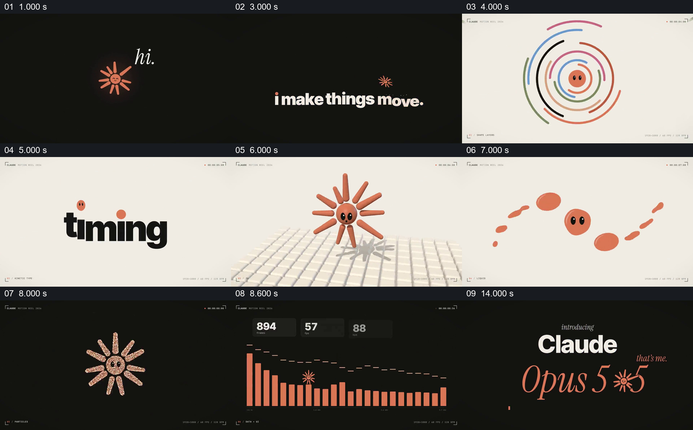
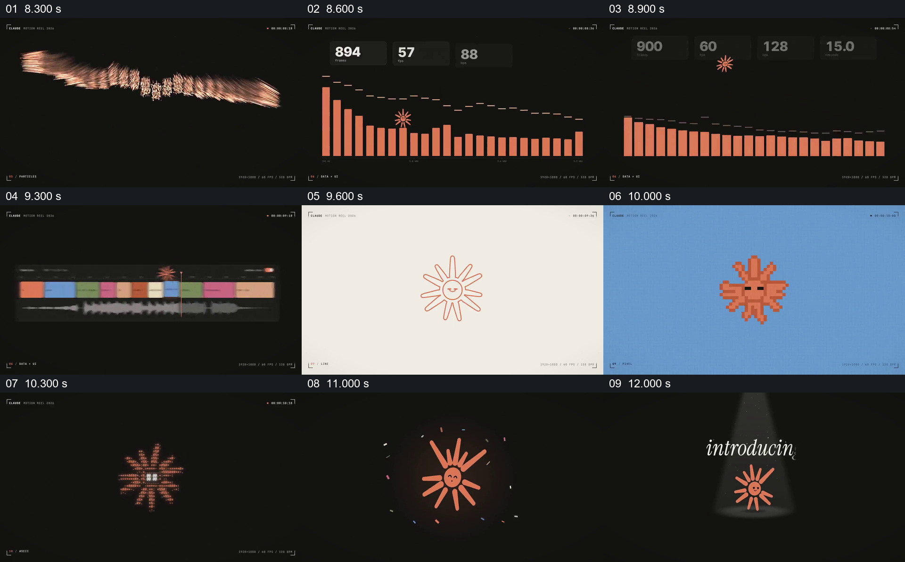

# 让同一图形角色亲自穿过多种动效，再揭晓身份

- 作品：案例 120《图形角色与数据排版》（索引名称）。
- 原片范围：00:00.000–00:15.061，含起点、不含终点；[完整原片及本卡片段](../video.mp4)。本卡覆盖整片，直接共用原文件。
- 观察方式：按原片 64 宫格和约每秒一次的原片抽帧观察整片，另核看下方两组源帧；未连续原速观看或听审，声音内容与语气未确认。原片视频及音频流可完整解码。

补充分镜源时间依次为 8300、8600、8900、9300、9600、10000、10300、11000、12000 毫秒。

## 原画面具体怎样设计

暗底上一个橙色放射形小角色出现，旁边先有“hi.”，接着逐步组成“i make things move.”。进入浅底展示后，角色的橙色脸与眼睛出现在彩色同心线条中心，又与 timing 等动态文字同屏。随后相同识别特征出现在有地面投影的立体放射体、变形的液态团和暗底粒子角色中。

角色继续出现在柱状图与时间线式界面附近；接下来又有线描、像素和由小字符组成的版本。不同处理之间背景与材质不断变化，橙色、脸部以及放射形轮廓使角色仍可辨认。它回到暗色背景，在聚光灯下等到“introducing”出现；最后标题揭晓“Claude Opus 5.5”，角色短暂占据标题数字之间的位置，旁边出现“that's me.”，片尾另有关于制作方式的文字说明。

## 为什么这样设计，好在哪里

片中不是把技术名称排成独立清单，而是让同一个角色成为每种表现的共同对象。观众先认识它，再看到它以不同材质和画面结构出现，因此变化可以被理解为同一角色的展示；脸、颜色和放射轮廓提供跨画面的识别线索，具体实现可以改变。结尾把角色放到名称中间，并让它回应“that's me.”，使身份揭晓与开头的自我介绍连成一段。

数据图、时间线与片尾关于制作方式的陈述是原片展示的一部分，不据此证明真实工程数据或独立核实制作来源。以上是作品分析，不代表作者自述或已测量的观众反应。

## 可直接使用的创意指令

当需要展示同一角色、品牌或产品具有多种表现方式，并且各方式对当前内容确有用途时，先用简短的出场和清楚的视觉特征建立主体身份。选取可以跨样式保持的少数识别点，例如轮廓、颜色或脸部关系，再让同一主体依次进入不同的图形、材质或信息场景；每种处理都应展示可辨认的具体变化，而不是只更换标签。保持这些识别点足以让观众认出前后是同一主体，必要时让主体与文字、图表或界面发生有意义的关系。演示完成后把主体接回正式名称或身份说明，形成与开场相呼应的收束。表现数量、角色设计、素材和技术由新任务决定；涉及产品能力、数据或制作来源的文字应有依据，示意画面不冒充真实输出。
