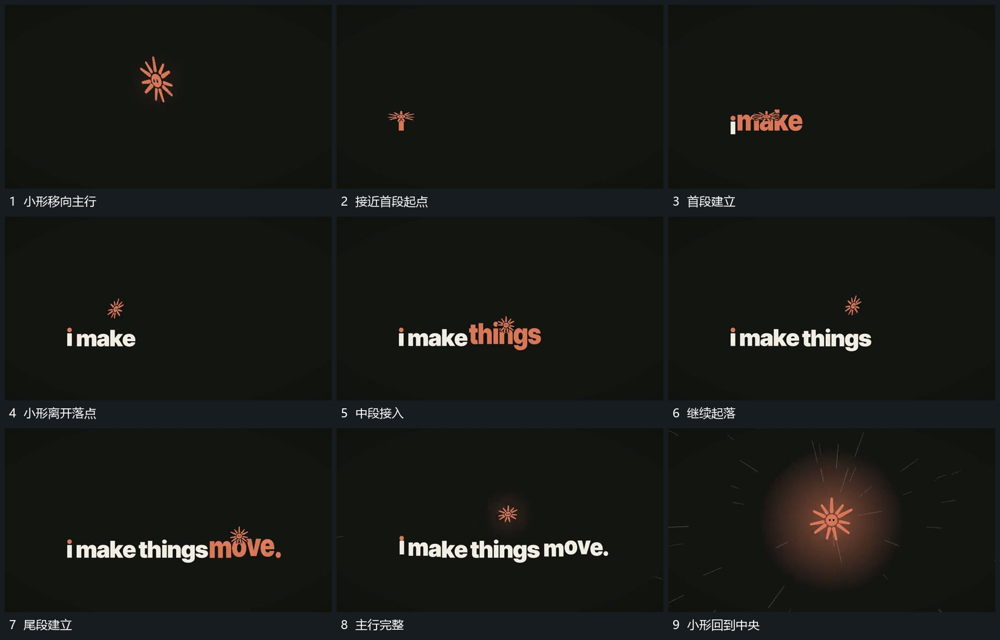

# 小形沿主行上方起落新段在落点附近接续

## 运动指令

让小形沿主行上方依次起落，接近某一落点时建立对应新段，已建立段保持。小形离开落点后继续向下一段推进，整行完整后回到中央，周边字片退让；同一小形贯穿全过程。

## 视频切片

[播放本机制的原片切片](m02.mp4)

覆盖分镜中“小形移向主行”至“小形回到中央”的连续过程，并保留邻近的前后衔接画面；原片中交叠发生的动作一并保留。

## 分镜过程

## 组合与调整

落点与新段位置由新片决定；新段建立必须与持续对象的经过有关，不另加无关入场。
