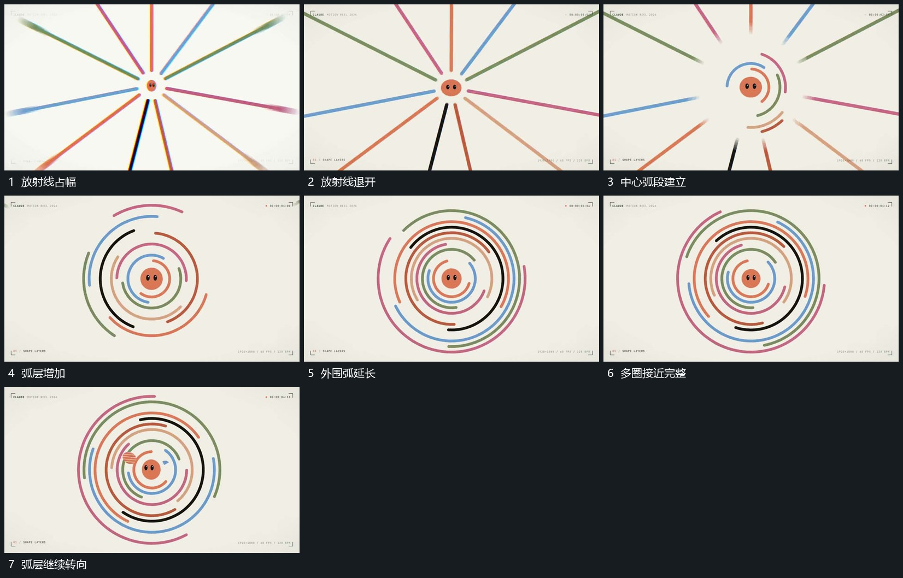

# 放射线向外退去同心弧从中心逐层延长

## 运动指令

中央小形保持，放射线向外围退去并缩短，中心附近先建立少量弧段。弧段沿共同圆心逐层向外补齐并延长，各层留出不同缺口且持续转向；直线完全退出后弧层仍运动。

## 视频切片

[播放本机制的原片切片](m03.mp4)

覆盖分镜中“放射线占幅”至“弧层继续转向”的连续过程，并保留邻近的前后衔接画面；原片中交叠发生的动作一并保留。

## 分镜过程

## 组合与调整

半径与层数可调整；共享圆心与逐层建立是必要关系，不推定原作者的路径生成算法。
