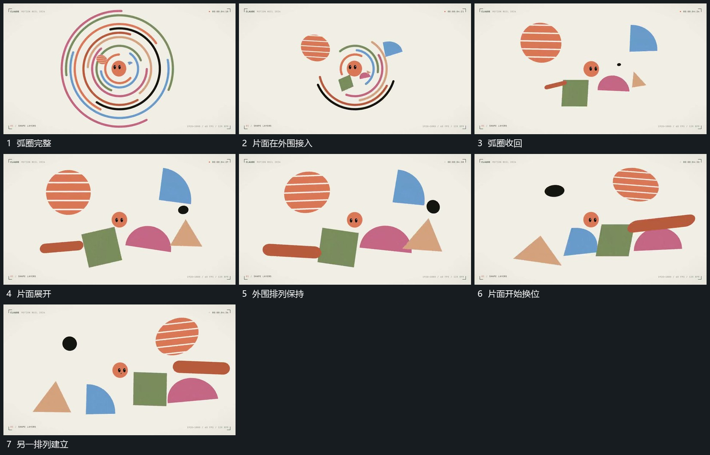

# 弧圈回收外围片面接入围绕中心换位

## 运动指令

保留中央小形，弧圈缩短并退去，外围少量片面在腾出的区域接入。片面各自转角、横移或竖移，错开换到中心另一侧，中央小形不跟整组漂走；完成一次换位后保留新的相对排列。

## 视频切片

[播放本机制的原片切片](m04.mp4)

覆盖分镜中“弧圈完整”至“另一排列建立”的连续过程，并保留邻近的前后衔接画面；原片中交叠发生的动作一并保留。

## 分镜过程

## 组合与调整

片面形状和数量自定；不宣称所有新片面都由原弧线变形而来，保留可见退让与接入的交叠。
