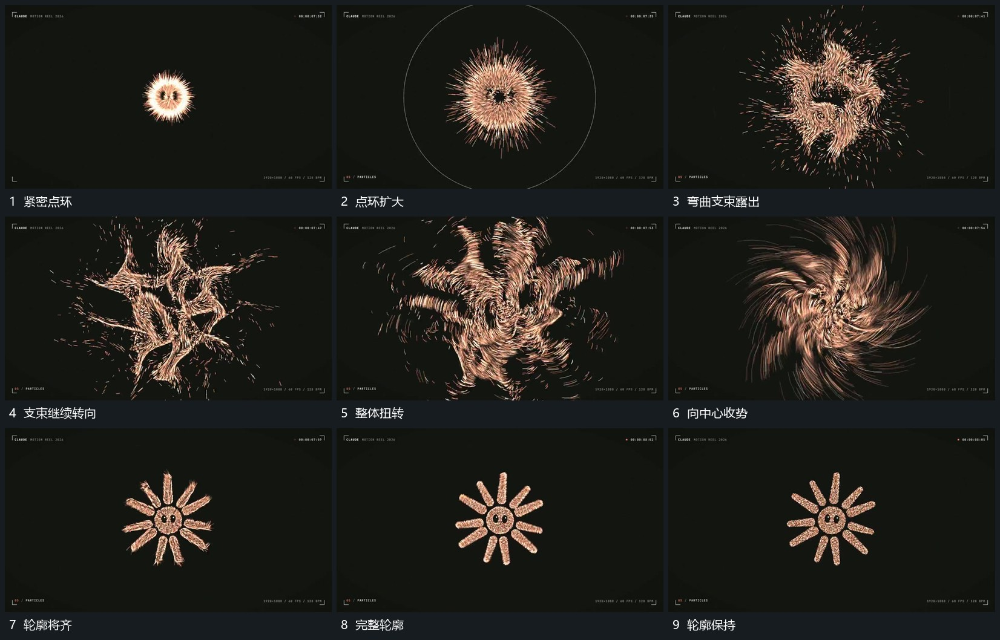

# 紧密点环展开弯曲支束再收成完整轮廓

## 运动指令

让点群从紧密中心扩大为环状范围，再拉出多个弯曲支束，支束绕中心持续转向，外围少量点向外散出。接着将点群收向同一主轮廓，先有可见残留支束，再逐步形成完整边界并保持。

## 视频切片

[播放本机制的原片切片](m08.mp4)

覆盖分镜中“紧密点环”至“轮廓保持”的连续过程，并保留邻近的前后衔接画面；原片中交叠发生的动作一并保留。

## 分镜过程

## 组合与调整

点群数量与轮廓自定；不把隐藏算法当作观察事实，扩散与聚合之间仍需连续的中途。
