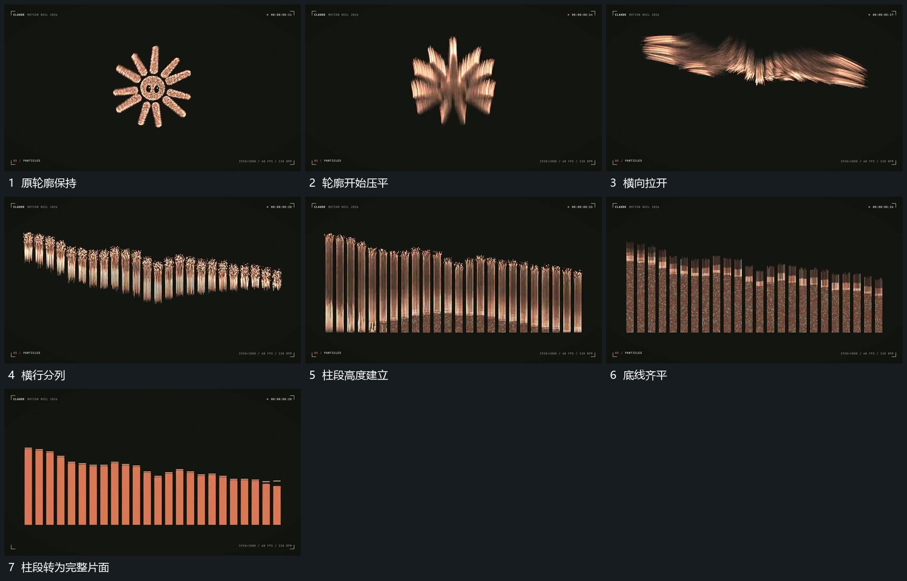

# 点群主轮廓压平拉成横行再分列为柱段

## 运动指令

保留原点群，先压低整体并向横向拉开，再将横行错开聚为多列，各列向上延长形成不同高度柱段。底线逐渐齐平，点群轮廓最后收成完整片面，为后续柱高变化留下参照。

## 视频切片

[播放本机制的原片切片](m09.mp4)

覆盖分镜中“原轮廓保持”至“柱段转为完整片面”的连续过程，并保留邻近的前后衔接画面；原片中交叠发生的动作一并保留。

## 分镜过程

## 组合与调整

列数和高度由新片决定；源点群到柱段之间保留重排过程，不将成形柱图直接切到旧轮廓上。
