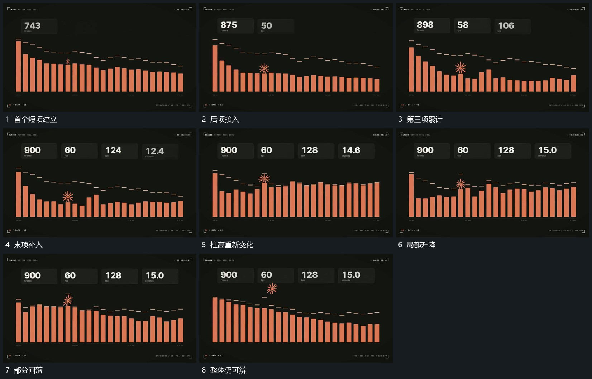

# 同底线柱段持续升降上方短项依次累计

## 运动指令

保持每根柱段的格位与底线，各段错开升高或回落，柱顶参照短线随对应高度调整。小形在柱组上方经过，上方短项依次累计，已建立项保持；柱高继续变化时上方布局仍稳定。

## 视频切片

[播放本机制的原片切片](m10.mp4)

覆盖分镜中“首个短项建立”至“整体仍可辨”的连续过程，并保留邻近的前后衔接画面；原片中交叠发生的动作一并保留。

## 分镜过程

## 组合与调整

不继承原数值与数量；依据新内容确定高度变化，不能把上下参照线与柱段运动分离。
