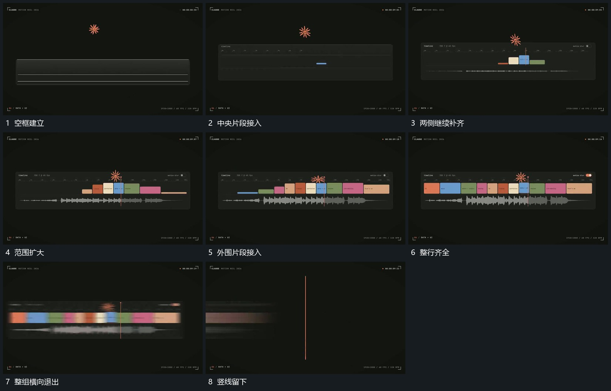

# 框内片段从中央向两侧补齐整组横向退出留竖线

## 运动指令

先保留框与中央参照，从中部引入首片，再向左右两侧错开补齐，相邻片保持各自边界，下方连续带同步延长。整组齐全后横向退出，原竖向标记保留在画面中，接给下一段细轮廓建立。

## 视频切片

[播放本机制的原片切片](m11.mp4)

覆盖分镜中“空框建立”至“竖线留下”的连续过程，并保留邻近的前后衔接画面；原片中交叠发生的动作一并保留。

## 分镜过程

## 组合与调整

框内片段可换为图片或短项；借的是累计方向与退出残留，不要求原编辑界面或具体用途。
