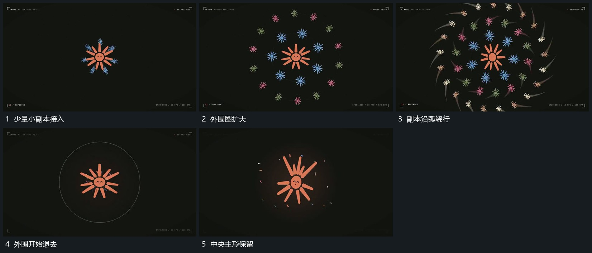

# 中央主形周围扩出小副本绕行后退出

## 运动指令

保留中央主形，小副本从近处向外围扩出多圈，沿弧形方向绕行，彼此错开而不与主形合成一块旋转。外围副本继续外移并退出，中心形保持，副本退去后才进入局部动作。

## 视频切片

[播放本机制的原片切片](m12.mp4)

覆盖分镜中“少量小副本接入”至“中央主形保留”的连续过程，并保留邻近的前后衔接画面；原片中交叠发生的动作一并保留。

## 分镜过程

## 组合与调整

数量可缩减；保留中心与副本的相对关系，不用整张副本图统一缩放代替各圈扩出。
