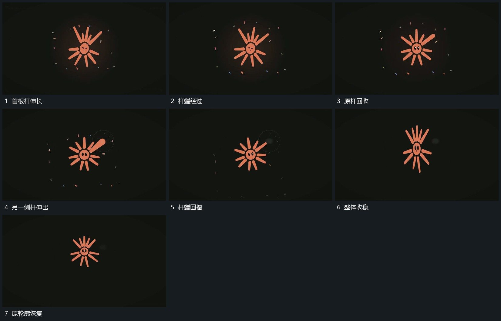

# 主形局部短杆伸出自由端摆动后回收

## 运动指令

保持主形中心，选一根短杆向外延长，自由端带小幅摆动，连接根部仍固定在原边缘。杆逐步回收后另一侧局部可以接续伸出；最后所有杆回到原长度，轮廓恢复。

## 视频切片

[播放本机制的原片切片](m13.mp4)

覆盖分镜中“首根杆伸长”至“原轮廓恢复”的连续过程，并保留邻近的前后衔接画面；原片中交叠发生的动作一并保留。

## 分镜过程

## 组合与调整

可只做一侧；拉伸来自明确根部，不让整形同时放大冒充局部杆长变化。
