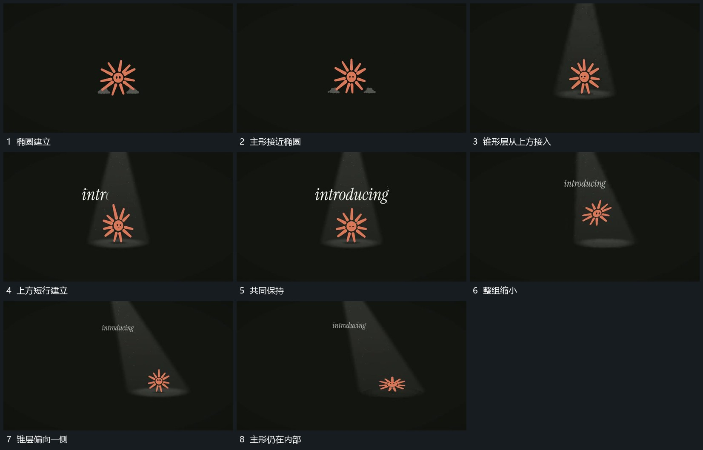

# 主形下移接触底部椭圆上方锥形层接入后转向

## 运动指令

让主形向下接近底部椭圆，接触附近略压低再恢复，上方锥形层接入并把主形包含在内部。附属行逐段建立后整组缩小，锥层逐渐偏向一侧，底部椭圆与内部主形持续跟随同一范围。

## 视频切片

[播放本机制的原片切片](m14.mp4)

覆盖分镜中“椭圆建立”至“主形仍在内部”的连续过程，并保留邻近的前后衔接画面；原片中交叠发生的动作一并保留。

## 分镜过程

## 组合与调整

不拆光色和材质；借的是接触、包含与共同转向关系，锥层方向不能改变而内部对象留在原位。
