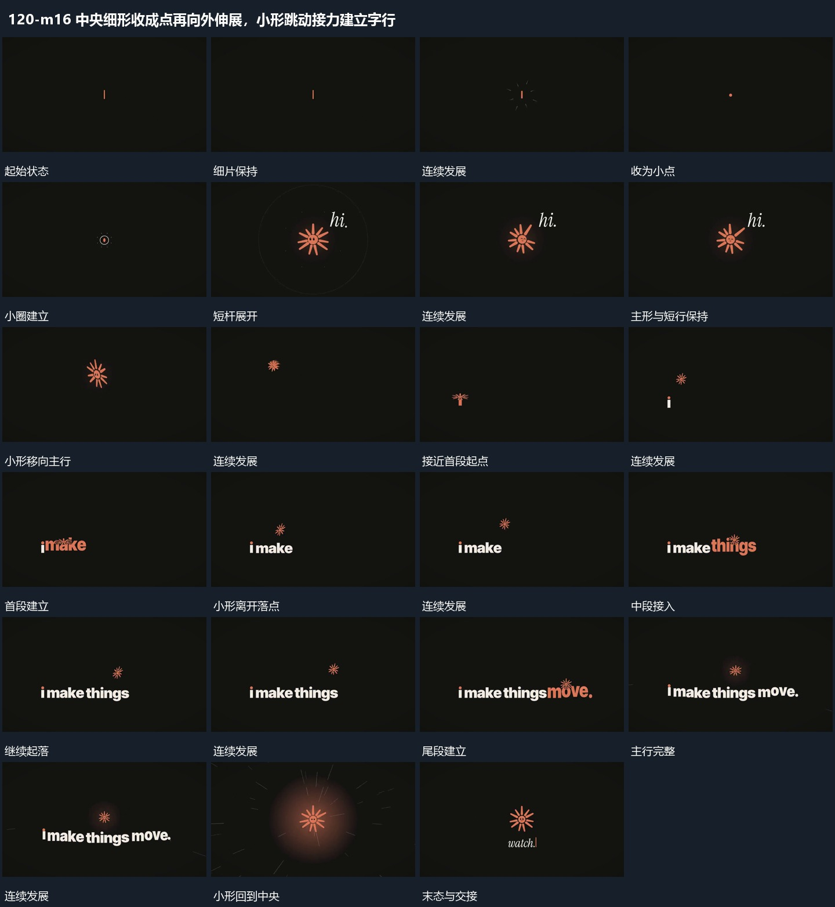

# 中央细形收成点再向外伸展，小形跳动接力建立字行

## 运动指令

细形先收拢为中心点，短杆向外伸出、圈线扩散；小形沿主行上方起落，每次落点附近补出新片段，整行建立后向局部回收。

1. **细片收成点中心短杆向外展开圈向外扩散**

先将细片收成小点，再围绕这个中心向外伸出短杆，圈从中心扩散向外。主形建立后圈退去，附近短行随后接入；保留中心位置和主形身份，为后面的位移提供同一对象。

2. **小形沿主行上方起落新段在落点附近接续**

让小形沿主行上方依次起落，接近某一落点时建立对应新段，已建立段保持。小形离开落点后继续向下一段推进，整行完整后回到中央，周边字片退让；同一小形贯穿全过程。

整段结束：主行完整小形返回中央 保留必要落稳与交接，中间已建立的参照沿用到下一步骤。

## 视频切片

[播放本机制的原片切片](m16.mp4)

保留起始准备、连续发展和完成或明确交接；首尾按本段运动范围裁切，不拼接、不变速。相连的小动作合为同一完整段落。

## 分镜过程

## 组合与调整

细形先收拢为中心点，短杆向外伸出、圈线扩散；小形沿主行上方起落，每次落点附近补出新片段，整行建立后向局部回收。 复用时可调整元素数量、幅度和相对节奏，保留上述进入、交叠与完成关系；不直接沿用原片题材或时长。

短杆和圈的数量可改；建立次序从小点发展，不直接把完整主形替换到细片位置。

落点与新段位置由新片决定；新段建立必须与持续对象的经过有关，不另加无关入场。
