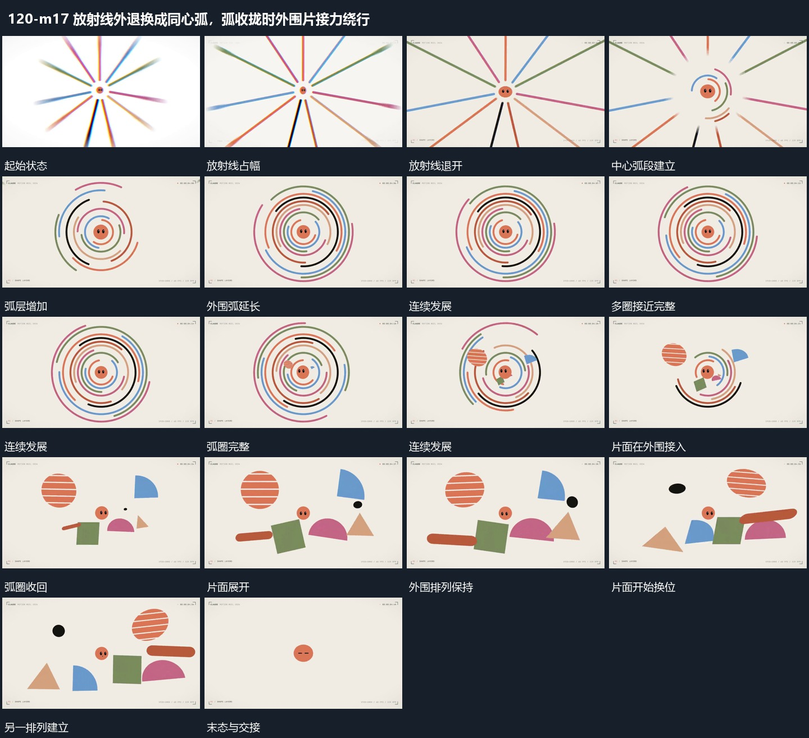

# 放射线外退换成同心弧，弧收拢时外围片接力绕行

## 运动指令

放射线向外退出，同心弧从中心逐层延长；弧圈向内收拢，外围片面接入并围绕中心换位，最后让出下一个中央锚点。

1. **放射线向外退去同心弧从中心逐层延长**

中央小形保持，放射线向外围退去并缩短，中心附近先建立少量弧段。弧段沿共同圆心逐层向外补齐并延长，各层留出不同缺口且持续转向；直线完全退出后弧层仍运动。

2. **弧圈回收外围片面接入围绕中心换位**

保留中央小形，弧圈缩短并退去，外围少量片面在腾出的区域接入。片面各自转角、横移或竖移，错开换到中心另一侧，中央小形不跟整组漂走；完成一次换位后保留新的相对排列。

整段结束：外围片面在中心四周换位 保留必要落稳与交接，中间已建立的参照沿用到下一步骤。

## 视频切片

[播放本机制的原片切片](m17.mp4)

保留起始准备、连续发展和完成或明确交接；首尾按本段运动范围裁切，不拼接、不变速。相连的小动作合为同一完整段落。

## 分镜过程

## 组合与调整

放射线向外退出，同心弧从中心逐层延长；弧圈向内收拢，外围片面接入并围绕中心换位，最后让出下一个中央锚点。 复用时可调整元素数量、幅度和相对节奏，保留上述进入、交叠与完成关系；不直接沿用原片题材或时长。

半径与层数可调整；共享圆心与逐层建立是必要关系，不推定原作者的路径生成算法。

片面形状和数量自定；不宣称所有新片面都由原弧线变形而来，保留可见退让与接入的交叠。
