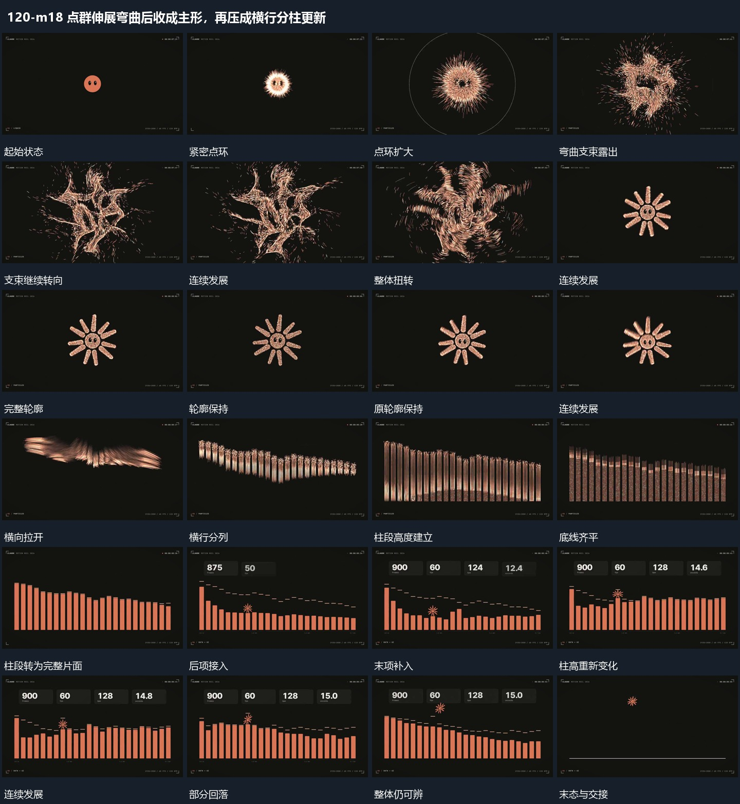

# 点群伸展弯曲后收成主形，再压成横行分柱更新

## 运动指令

紧密点群展开弯曲支束再收回完整轮廓；轮廓压平拉成横行，横行分为同基线柱段，各柱升降时上方短项逐次累积，结果共同落稳。

1. **紧密点环展开弯曲支束再收成完整轮廓**

让点群从紧密中心扩大为环状范围，再拉出多个弯曲支束，支束绕中心持续转向，外围少量点向外散出。接着将点群收向同一主轮廓，先有可见残留支束，再逐步形成完整边界并保持。

2. **点群主轮廓压平拉成横行再分列为柱段**

保留原点群，先压低整体并向横向拉开，再将横行错开聚为多列，各列向上延长形成不同高度柱段。底线逐渐齐平，点群轮廓最后收成完整片面，为后续柱高变化留下参照。

3. **同底线柱段持续升降上方短项依次累计**

保持每根柱段的格位与底线，各段错开升高或回落，柱顶参照短线随对应高度调整。小形在柱组上方经过，上方短项依次累计，已建立项保持；柱高继续变化时上方布局仍稳定。

整段结束：附属短项齐全柱段仍局部变化 保留必要落稳与交接，中间已建立的参照沿用到下一步骤。

## 视频切片

[播放本机制的原片切片](m18.mp4)

保留起始准备、连续发展和完成或明确交接；首尾按本段运动范围裁切，不拼接、不变速。相连的小动作合为同一完整段落。

## 分镜过程

## 组合与调整

紧密点群展开弯曲支束再收回完整轮廓；轮廓压平拉成横行，横行分为同基线柱段，各柱升降时上方短项逐次累积，结果共同落稳。 复用时可调整元素数量、幅度和相对节奏，保留上述进入、交叠与完成关系；不直接沿用原片题材或时长。

点群数量与轮廓自定；不把隐藏算法当作观察事实，扩散与聚合之间仍需连续的中途。

列数和高度由新片决定；源点群到柱段之间保留重排过程，不将成形柱图直接切到旧轮廓上。

不继承原数值与数量；依据新内容确定高度变化，不能把上下参照线与柱段运动分离。
