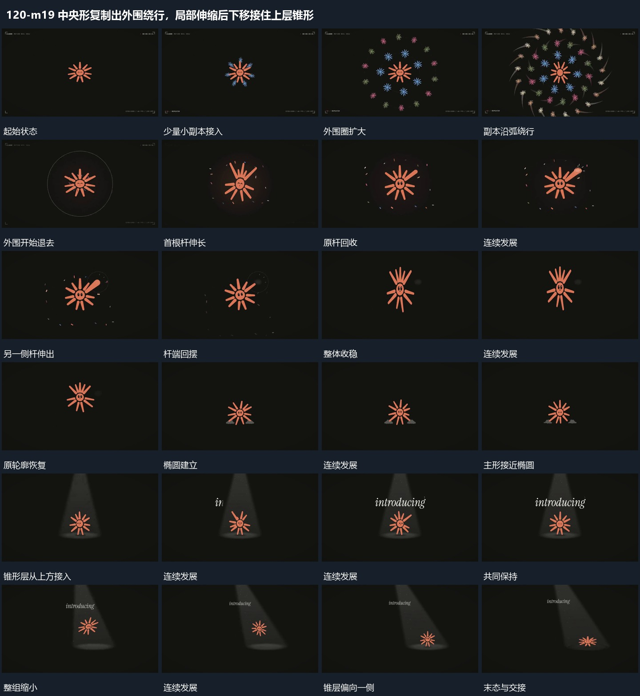

# 中央形复制出外围绕行，局部伸缩后下移接住上层锥形

## 运动指令

中央主形周围扩出小副本绕行并退出；局部短杆从主形伸出、摆动后收回，主形下移接触底部椭圆，上层锥形接入并转向。

1. **中央主形周围扩出小副本绕行后退出**

保留中央主形，小副本从近处向外围扩出多圈，沿弧形方向绕行，彼此错开而不与主形合成一块旋转。外围副本继续外移并退出，中心形保持，副本退去后才进入局部动作。

2. **主形局部短杆伸出自由端摆动后回收**

保持主形中心，选一根短杆向外延长，自由端带小幅摆动，连接根部仍固定在原边缘。杆逐步回收后另一侧局部可以接续伸出；最后所有杆回到原长度，轮廓恢复。

3. **主形下移接触底部椭圆上方锥形层接入后转向**

让主形向下接近底部椭圆，接触附近略压低再恢复，上方锥形层接入并把主形包含在内部。附属行逐段建立后整组缩小，锥层逐渐偏向一侧，底部椭圆与内部主形持续跟随同一范围。

整段结束：锥形层与内部主形一起偏向一侧 保留必要落稳与交接，中间已建立的参照沿用到下一步骤。

## 视频切片

[播放本机制的原片切片](m19.mp4)

保留起始准备、连续发展和完成或明确交接；首尾按本段运动范围裁切，不拼接、不变速。相连的小动作合为同一完整段落。

## 分镜过程

## 组合与调整

中央主形周围扩出小副本绕行并退出；局部短杆从主形伸出、摆动后收回，主形下移接触底部椭圆，上层锥形接入并转向。 复用时可调整元素数量、幅度和相对节奏，保留上述进入、交叠与完成关系；不直接沿用原片题材或时长。

数量可缩减；保留中心与副本的相对关系，不用整张副本图统一缩放代替各圈扩出。

可只做一侧；拉伸来自明确根部，不让整形同时放大冒充局部杆长变化。

不拆光色和材质；借的是接触、包含与共同转向关系，锥层方向不能改变而内部对象留在原位。
