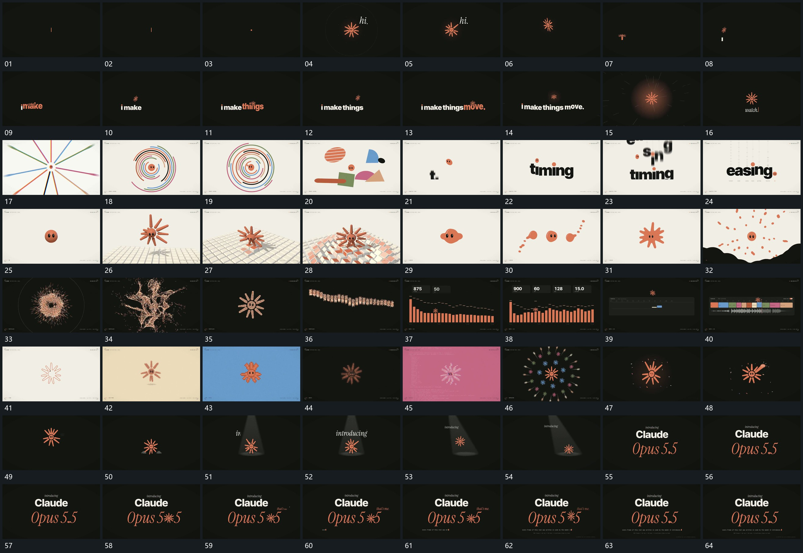

# 120｜原片运动总览

[观看完整原片](video.mp4)

## 运动总览

开头细片收成点中心短杆向外展开圈向外扩散把细片收成小点，再由中心向外展开短杆与圈；小形沿主行上方起落新段在落点附近接续让小形沿新主行上方起落，新段在落点附近依次建立。小形回到中央后切入放射线向外退去同心弧从中心逐层延长的放射线回收与多圈弧段延长，接着弧圈回收外围片面接入围绕中心换位让弧圈退让，外围片面接入并换位。

中央小形继续保留，字片错开下降落稳下一行进入时旧行向下退去让字片沿竖向错开落位并让下一行接管。随后主形长出短杆落到格面后格片由接点向外起伏从主形边缘长出短杆，落到格面时让格片沿接触位置向外起伏。格面回收后，主形边缘伸出分为侧片再收合并向外散开将主形边缘伸出、分成侧片、重新收合，再向外散开，底部覆盖面接管背景。

紧密点环展开弯曲支束再收成完整轮廓将点群从紧密环展开为弯曲支束，再收回轮廓，点群主轮廓压平拉成横行再分列为柱段把这份点群压平拉开并重新分列为柱段。同底线柱段持续升降上方短项依次累计保持底线改变柱高，附属短行逐步建立；之后框内片段从中央向两侧补齐整组横向退出留竖线从中央向两侧补齐框内片段，整组横向退出只留一条竖线。竖线附近建立细轮廓，随后几次同中心的形态直接切换不拆成美术卡。

中央主形周围扩出小副本绕行后退出在中央主形周围扩出多圈小副本，副本绕行后退出；主形局部短杆伸出自由端摆动后回收让主形局部短杆外伸后回收。主形下移接触底部椭圆上方锥形层接入后转向将主形下移接触底部椭圆，上方锥形层建立并带着内部排列转向。最后切到双行，行内局部展开为小形短标记与附属行随后建立让下行局部展开为小形，短标记与附属行随后建立，共同保持结束。

## 完整运动段落

以下按原片中的出现顺序引用。建立、内部发展及完成反馈放在同一段中；同时发生的局部动作与运镜写在同一份指令里。不同段之间可以是连续接管，也可以是直接切换，不能仅凭条目相邻认定可直接拼接。重复出现的同类运动采用一次连续代表范围，切片不以逐段无缝覆盖整片为目标。

1. [中央细形收成点再向外伸展，小形跳动接力建立字行](mechanisms/m16.md)：细形先收拢为中心点，短杆向外伸出、圈线扩散；小形沿主行上方起落，每次落点附近补出新片段，整行建立后向局部回收。

2. [放射线外退换成同心弧，弧收拢时外围片接力绕行](mechanisms/m17.md)：放射线向外退出，同心弧从中心逐层延长；弧圈向内收拢，外围片面接入并围绕中心换位，最后让出下一个中央锚点。

3. [字片错开下降落稳下一行进入时旧行向下退去](mechanisms/m05.md)：错开下降上下接管

4. [主形长出短杆落到格面后格片由接点向外起伏](mechanisms/m06.md)：短杆建立接触波向外传播

5. [主形边缘伸出分为侧片再收合并向外散开](mechanisms/m07.md)：伸出分离收合散开

6. [点群伸展弯曲后收成主形，再压成横行分柱更新](mechanisms/m18.md)：紧密点群展开弯曲支束再收回完整轮廓；轮廓压平拉成横行，横行分为同基线柱段，各柱升降时上方短项逐次累积，结果共同落稳。

7. [框内片段从中央向两侧补齐整组横向退出留竖线](mechanisms/m11.md)：中央累计向两侧展开再横退

8. [中央形复制出外围绕行，局部伸缩后下移接住上层锥形](mechanisms/m19.md)：中央主形周围扩出小副本绕行并退出；局部短杆从主形伸出、摆动后收回，主形下移接触底部椭圆，上层锥形接入并转向。

9. [行内局部展开为小形短标记与附属行随后建立](mechanisms/m15.md)：局部展开后补标记再回收

切片保留起始准备、必要内部停顿和完成或明确交接；首尾省略无新发展的等待，持续运动不要求人为停住。以上基于真实源帧序列和重点边界核对，不等同于全片连续声画审片。

## 完整64宫格

