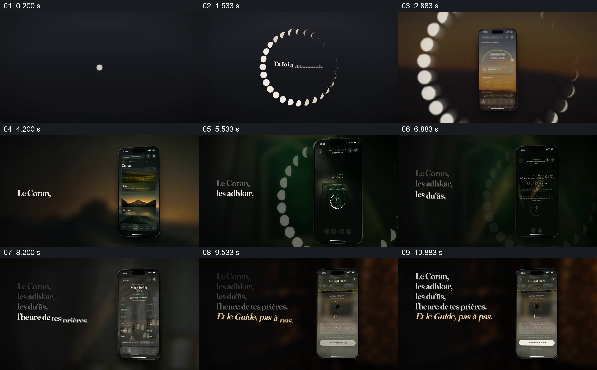

# 让功能名称逐项累积，手机同步切换对应页面

- 作品：案例 035《宗教应用的功能清单》（索引名称）。
- 原片范围：00:00.000–00:12.000，含起点、不含终点；[完整原片](../video.mp4)｜[本卡片段](c01.mp4)。
- 观察方式：依据整片 64 宫格和约每秒一次的真实源帧观察，未连续原速观看或听审；声音、语气与完整播放节奏未确认。

## 原画面具体怎样设计

深色背景上月相小圆排列成环，中央出现法语提示；手机进入暖色背景。左侧依次增加古兰经、纪念词、祈祷、礼拜时间和指南等文字，右侧手机同步出现不同页面，前面已有的文字仍在左侧形成清单。

## 为什么这样设计，好在哪里

文字逐项留下来，观众能看到功能集合不断增加；手机页面为当前增加的功能提供具体位置。界面内容及宗教文字准确性没有独立核验。

以上为依据画面的分析，非作者自述；预期观看效果未经观众测试。

## 可直接使用的创意指令

当介绍相关的一组功能时，选取真实可展示的功能页面，让功能名称逐项加入同一清单，并在相邻位置同步展示对应界面；给每项足够阅读时间。宗教或其他专业内容应由可靠来源及合适的专业人员核对。
