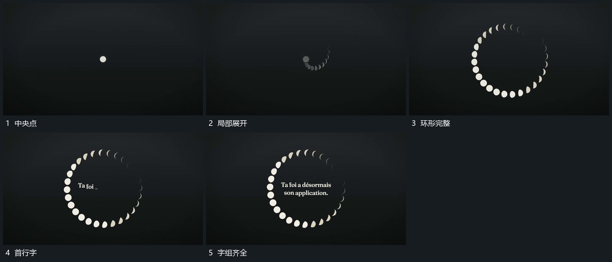

# 中央点扩成分段圆环，圈内文字逐行补入

## 运动指令

从中央小点向外展开一圈小形，让小形沿圆周构成分段圆环。圆环建立后在内侧逐行补入文字，先出现行保持，环形继续保留为边界。

## 视频切片

[播放本机制的原片切片](m01.mp4)

覆盖分镜中“中央点”至“字组齐全”的连续过程，并保留邻近的前后衔接画面；原片中交叠发生的动作一并保留。

## 分镜过程

## 组合与调整

不推定小形的隐藏几何。可用其他分段形，保留由点扩到圈、文字后到的关系。
