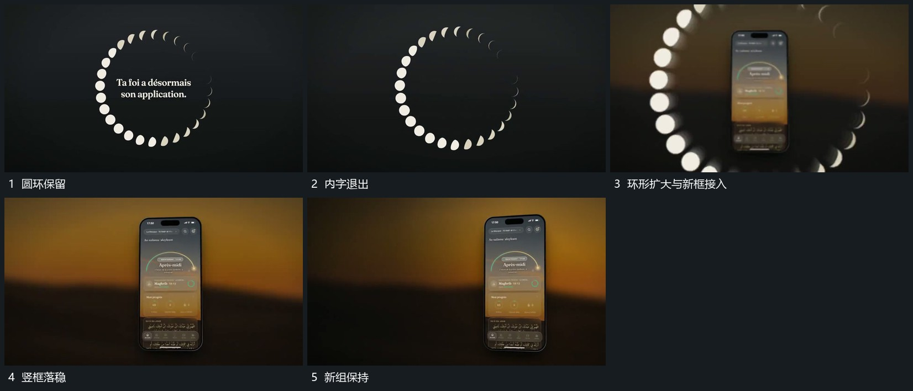

# 圆环放大越界，竖框从中心接管并换底

## 运动指令

先让圈内字退出，再放大圆环，分段小形向画面外缘越出。新竖框在环内空间接入，后层同步接替，圆环经过边缘后退出，让竖框成为新的中心。

## 视频切片

[播放本机制的原片切片](m02.mp4)

覆盖分镜中“圆环保留”至“新组保持”的连续过程，并保留邻近的前后衔接画面；原片中交叠发生的动作一并保留。

## 分镜过程

## 组合与调整

框不必是固定物体，重要的是它接在扩张空出的中心，不另开无关入场方向。
