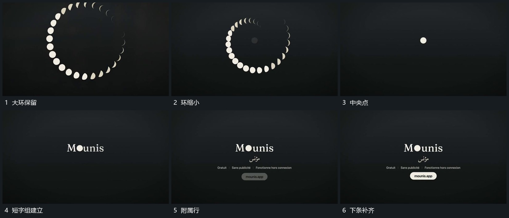

# 大圆环缩回中央点，点接入短字组后补齐附属项

## 运动指令

竖框退虚后让大圆环接手，再向中央缩回。分段环收成小点，随后从小点所在位置接入短字组；附属行与下方小条依次补齐，结尾整体保持。

## 视频切片

[播放本机制的原片切片](m04.mp4)

覆盖分镜中“大环保留”至“下条补齐”的连续过程，并保留邻近的前后衔接画面；原片中交叠发生的动作一并保留。

## 分镜过程

## 组合与调整

点与新字组之间要有位置联系。附属项后到，避免收束时整套结尾同时闪现。
