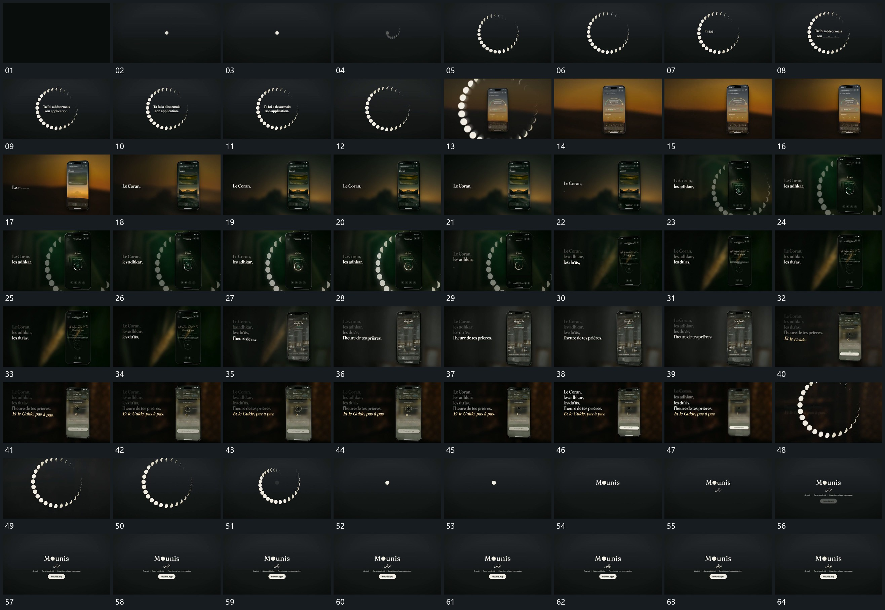

# 035｜原片运动总览

[观看完整原片](video.mp4)

## 运动总览

开场 中央点扩成分段圆环，圈内文字逐行补入 从中央点扩成一圈分段小形，圈内文字逐行增加。圆环放大越界，竖框从中心接管并换底 让环形组放大越过画面边缘，同时新竖框接入并换底。中段 固定竖框内轮换，旁侧字组逐行累积 保留竖框位置，内部内容依次接替，旁侧文字逐行累积；环形后层也曾在竖框旁重新建立。

末段竖框退虚并让环形接手，大圆环缩回中央点，点接入短字组后补齐附属项 将大圈收回中央点，再从该点接上短字组，附属行和小条最后补入，整体保持。

## 完整运动段落

以下按原片中的出现顺序引用。建立、内部发展及完成反馈放在同一段中；同时发生的局部动作与运镜写在同一份指令里。不同段之间可以是连续接管，也可以是直接切换，不能仅凭条目相邻认定可直接拼接。重复出现的同类运动采用一次连续代表范围，切片不以逐段无缝覆盖整片为目标。

1. [中央点扩成分段圆环，圈内文字逐行补入](mechanisms/m01.md)：点扩开，文字随后建立

2. [圆环扩张让出竖框，内部轮换与旁字接力完成](mechanisms/m05.md)：圆环向外扩张越界，新竖框从中心接管；竖框保持，内部状态轮换与旁字累积交叠完成。

3. [大圆环缩回中央点，点接入短字组后补齐附属项](mechanisms/m04.md)：环先缩回，点与字接力

切片保留起始准备、必要内部停顿和完成或明确交接；首尾省略无新发展的等待，持续运动不要求人为停住。以上基于真实源帧序列和重点边界核对，不等同于全片连续声画审片。

## 完整64宫格

