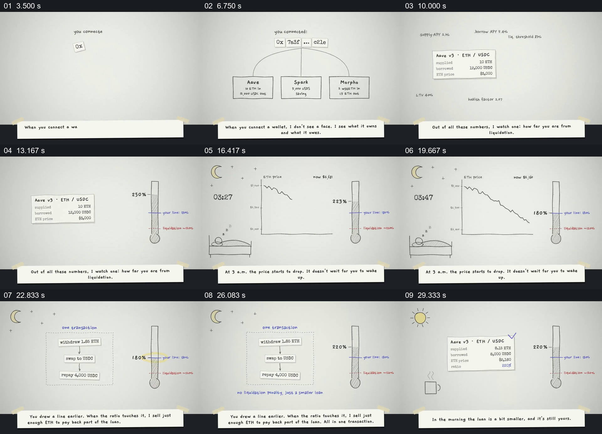

# 用睡眠、下跌曲线和刻度线讲一次夜间自动处理

- 作品：案例 054，手绘金融工具解释（库内案例）。
- 原片范围：3.000–32.000 秒；[完整原片](../video.mp4)｜[本卡片段](c01.mp4)。含起点、不含终点。
- 观察方式：查看整片 64 格与本卡九宫格；原片无音轨，未独立完成连续原速观看，画面动作和停顿仍待复核；金融数据与产品能力未独立核实，迁移未实测。

## 原画面具体怎样设计

浅灰纸面上方先由钱包地址接出三个协议小框，随后其中一项账户被单独选出；账户卡写有抵押、借款和价格，旁边逐渐画出竖直刻度，蓝线是预设线、红虚线是片中清算线，当前比率显示在更高位置。

画面进入夜晚：左下是躺在床上的人物与月亮，中间是逐渐向右下方延伸的价格线，右侧保留同一刻度；不同时刻数字下降，直至达到蓝色预设线。左侧曲线让位于一个虚线交易框，里面依次显示取出、兑换和偿还三步；右侧比率随后上升。最后月亮换成太阳，账户卡重新出现，余额和比率已变化，床与风险刻度留下前后对照。底部始终有一张贴纸样式的英文叙述条。

## 为什么这样设计，好在哪里

价格下降、熟睡人物和保留的阈值刻度同时出现，把抽象风险放到“人在休息而条件继续变化”的具体情境里。触发点到达后，交易三步占据曲线的位置，而右侧刻度不变，观众能够把动作和风险指标的前后状态联系起来。

次日账户卡回到原来的角色，显示的是处理后余额，而非仅显示一个成功图标。交易、数值和无清算结果是片中假设演示，不是本次核实的金融结果；画面与字幕不能证明具体时间或声音同步。

## 可直接使用的创意指令

当真实流程有预先设定的条件、外部变化和可核对的处理结果时，先给一个清楚的初始状态及触发阈值；同时展示受影响的对象与正在变化的指标，让阈值在整个过程中保持可见。触发后，用少量明确步骤说明处理对象如何改变，再回到相同指标和账户或设备，展示结果。

人物、夜晚、手绘、曲线与刻度样式可变；需要保留条件、触发、实际动作与前后状态的对应。金融或其他高风险数据需标示来源和假设，不能以模拟画面承诺效果。
