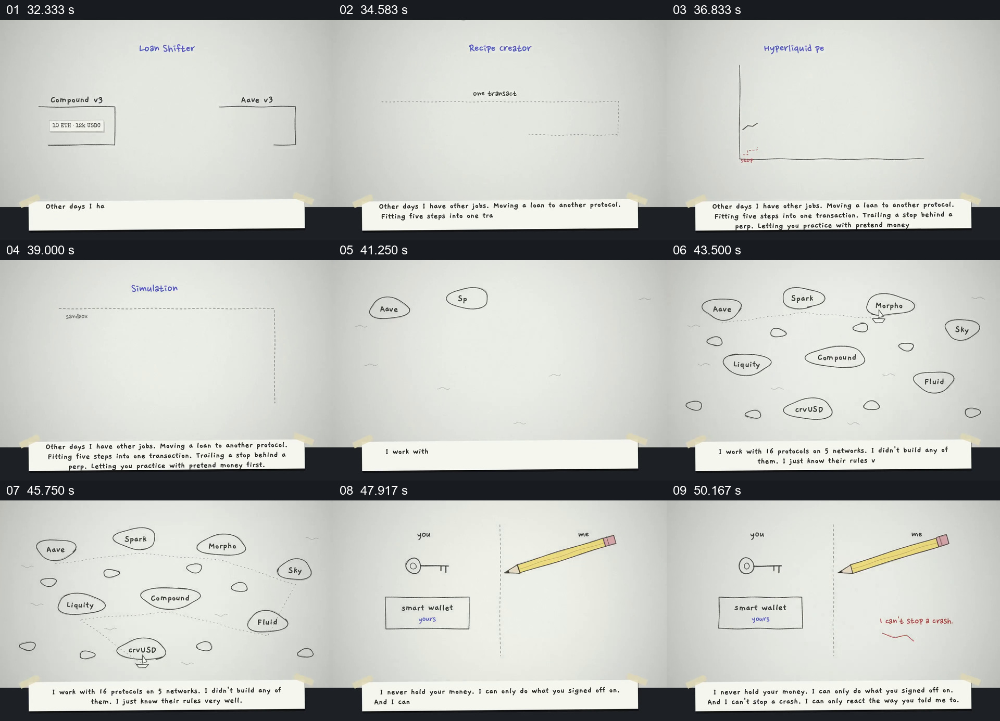

# 用不同小图逐项展示工具职责和权限边界

- 作品：案例 054《借贷风险与自动操作的手绘说明》（索引名称）。
- 原片范围：00:32.000–00:52.000，含起点、不含终点；[完整原片](../video.mp4)｜[本卡片段](c02.mp4)。
- 观察方式：依据整片 64 宫格和约每秒一次的真实源帧观察，未连续原速观看；原片无音轨，完整播放节奏未确认。

## 原画面具体怎样设计

纸面上贷款从一个方框移向另一个，多个步骤排在一条交易框中；价格曲线与模拟沙盒随后出现。最后画面左右分开，用户侧有钥匙与钱包，工具侧是铅笔和关于权限的文字。

## 为什么这样设计，好在哪里

每种功能使用不同小图，最后通过左右分栏突出责任归属。功能与资产控制权是片中宣传，未进行安全或产品验证。

以上为依据画面的分析，非作者自述；预期观看效果未经观众测试。

## 可直接使用的创意指令

介绍工具的能力与边界时，分别展示真实可用操作及结果，再用用户和工具的分栏说明谁能授权、持有和执行什么；具体权限与风险应依据实际合同和系统验证。
