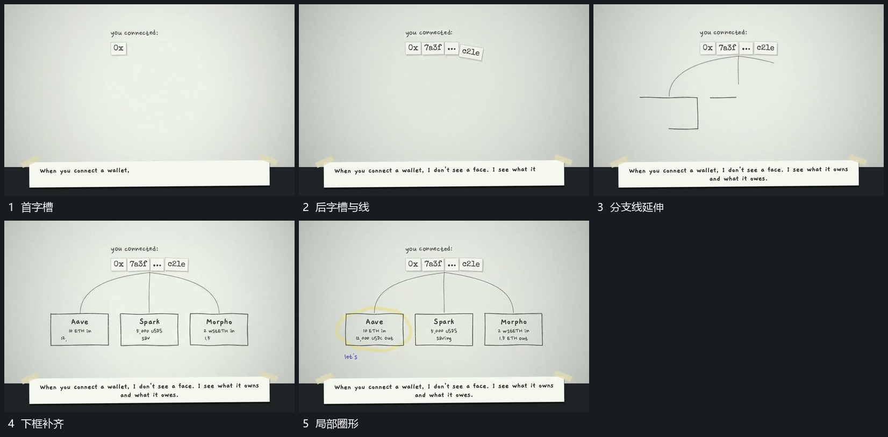

# 上方字槽逐项建立，分支线延伸后下框补齐

## 运动指令

先在上方补齐字槽，再从其下延伸分支线。各分支到目标位置后建立下框，框内内容逐项增加；最后画圈限定一个框，其余框保持。

## 视频切片

[播放本机制的原片切片](m01.mp4)

覆盖分镜中“首字槽”至“局部圈形”的连续过程，并保留邻近的前后衔接画面；原片中交叠发生的动作一并保留。

## 分镜过程

## 组合与调整

分支数量可调，保留先连接后承载区的来源关系。
