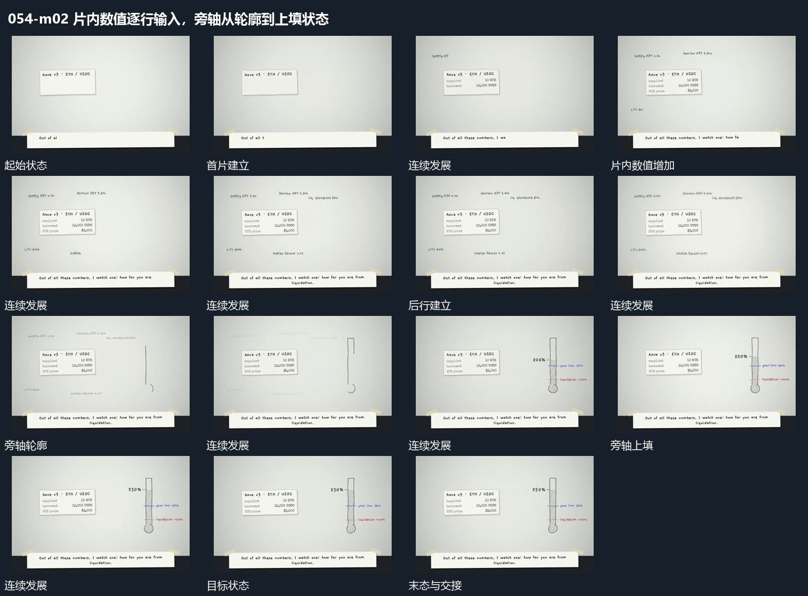

# 片内数值逐行输入，旁轴从轮廓到上填状态

## 运动指令

在固定片面内逐行输入数值和短行，内容建立后在旁侧描出竖轴轮廓，再沿轴上填到目标位置，补入局部横标与数值。

## 视频切片

[播放本机制的原片切片](m02.mp4)

保留起始准备、连续发展和完成或明确交接；首尾按本段运动范围裁切，不拼接、不变速。尾部只保留理解结果所需的展示。

## 分镜过程

## 组合与调整

不继承原指标用途，只规定片到轴的建立顺序。
