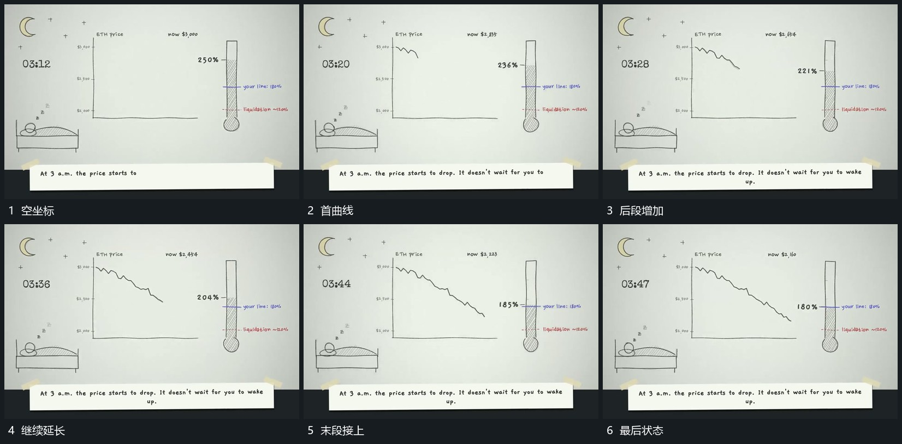

# 固定坐标内曲线逐段延长，旁轴高度与数值随之变化

## 运动指令

保留坐标区和旁轴，让曲线从左向右逐段延长。线新增部分向不同高度接续，旁轴内部高度及数值随推进变化；末端到位后各区共同稳定。

## 视频切片

[播放本机制的原片切片](m03.mp4)

覆盖分镜中“空坐标”至“最后状态”的连续过程，并保留邻近的前后衔接画面；原片中交叠发生的动作一并保留。

## 分镜过程

## 组合与调整

只描述可见联动，不推定原片计算公式。虚线追随可作为同一轨迹的附属层。
