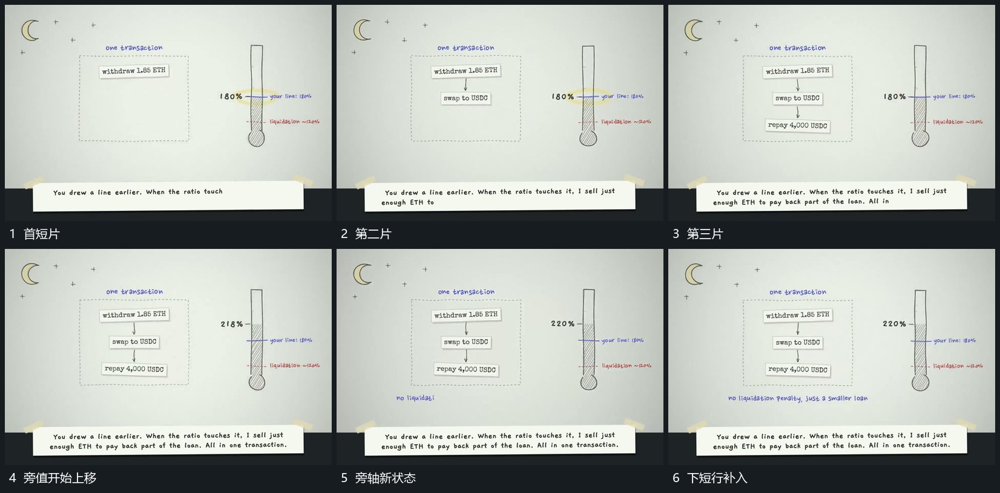

# 竖向短片逐项补入，以箭头连接，旁轴随后上移

## 运动指令

在虚线范围中先放上方短片，再逐项补下片，用短箭头连接已有项。完整纵列建立后旁轴内部上移、数值更新，下方说明最后接入。

## 视频切片

[播放本机制的原片切片](m04.mp4)

覆盖分镜中“首短片”至“下短行补入”的连续过程，并保留邻近的前后衔接画面；原片中交叠发生的动作一并保留。

## 分镜过程

## 组合与调整

箭头应在两片已存在后出现，反馈别抢在过程前结束。
