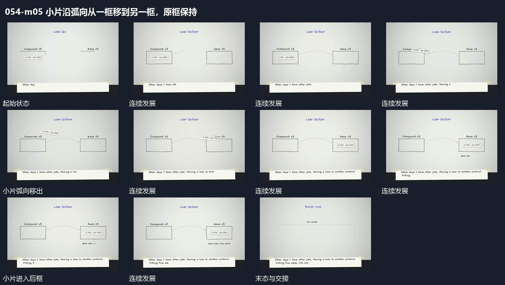

# 小片沿弧向从一框移到另一框，原框保持

## 运动指令

保留并置两框，让小片从首框内部沿弧向移出，到达另一框内部后落稳。源框仍在，目标框接收后再更新附属短字。

## 视频切片

[播放本机制的原片切片](m05.mp4)

覆盖分镜中“首框与小片”至“后续组接入”的连续过程，并保留邻近的前后衔接画面；原片中交叠发生的动作一并保留。

## 分镜过程

## 组合与调整

路径需落向真实目标区，不把跨框转移做成无关漂浮。
