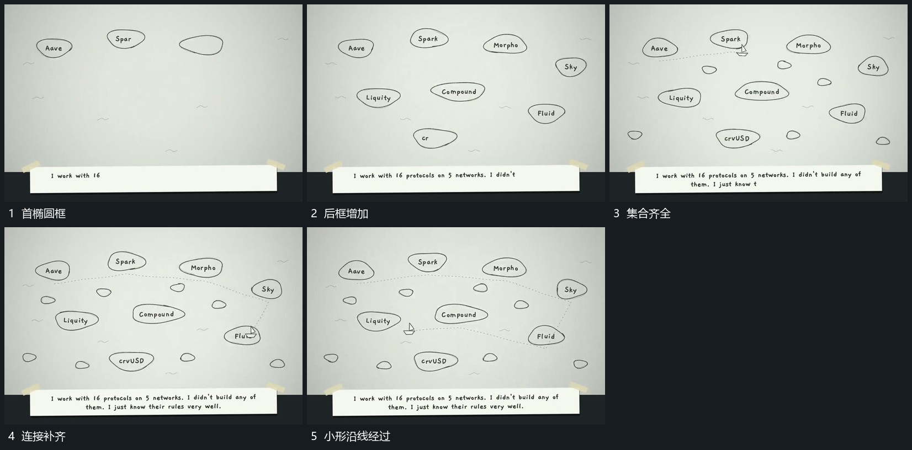

# 外围椭圆框依次建立，虚线补齐后小形沿连接经过

## 运动指令

从少量椭圆框开始补齐外围框群，已出现框保持。随后在框间补虚线连接，小形沿连接经过已有框，框群位置不跟着小形移动。

## 视频切片

[播放本机制的原片切片](m06.mp4)

覆盖分镜中“首椭圆框”至“小形沿线经过”的连续过程，并保留邻近的前后衔接画面；原片中交叠发生的动作一并保留。

## 分镜过程

## 组合与调整

不推定网络功能，按新片所需关联设置路径和终点。
