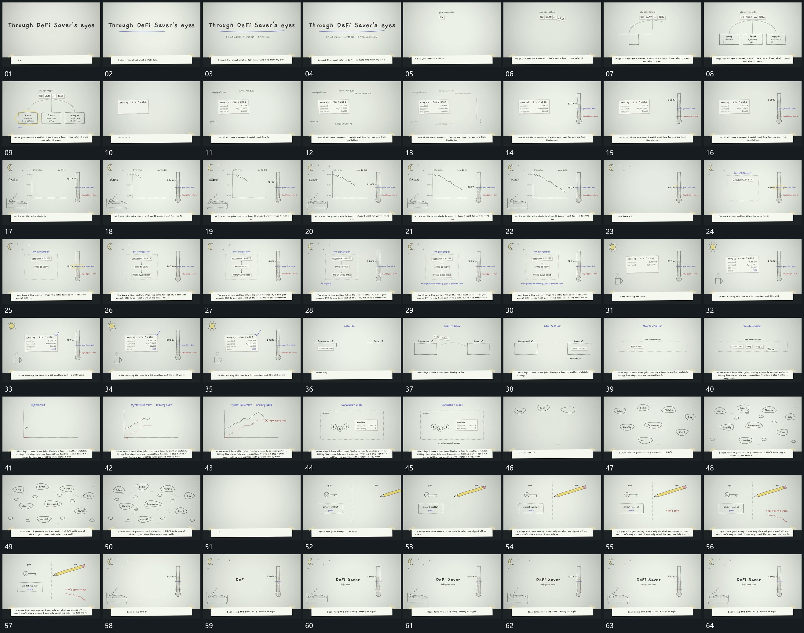

# 054｜原片运动总览

[观看完整原片](video.mp4)

## 运动总览

开头主字逐字建立，下线延长，底部固定长条持续输入。上方字槽逐项建立，分支线延伸后下框补齐 从上方字槽延伸分支线，再补下方空框及内容，局部圈形最后标出一框。片内数值逐行输入，旁轴从轮廓到上填状态 在片内逐行输入数值，旁侧竖轴从轮廓到填充；随后 固定坐标内曲线逐段延长，旁轴高度与数值随之变化 在固定坐标中延长曲线，旁轴高度与数值同步下降。

中段 竖向短片逐项补入，以箭头连接，旁轴随后上移 从上到下追加短片，以箭头连接，旁轴随后上移到新位置。小片沿弧向从一框移到另一框，原框保持 用弧向运动把小片从一个框交给另一框。固定坐标内曲线逐段延长，旁轴高度与数值随之变化 再次描出长曲线，后方虚线跟随，末端短标记接上。外围椭圆框依次建立，虚线补齐后小形沿连接经过 让外围椭圆框从少到多建立，框间虚线补齐，小形沿连接经过。末段并置两区补入局部形与短线，旧组退出后回到稳定竖轴与中央字组，底部长条完成输入收尾。

## 完整运动段落

以下按原片中的出现顺序引用。建立、内部发展及完成反馈放在同一段中；同时发生的局部动作与运镜写在同一份指令里。不同段之间可以是连续接管，也可以是直接切换，不能仅凭条目相邻认定可直接拼接。重复出现的同类运动采用一次连续代表范围，切片不以逐段无缝覆盖整片为目标。

1. [上方字槽逐项建立，分支线延伸后下框补齐](mechanisms/m01.md)：字槽先在，线后延伸，框再补入

2. [片内数值逐行输入，旁轴从轮廓到上填状态](mechanisms/m02.md)：片内先建立，轴形后接

3. [固定坐标内曲线逐段延长，旁轴高度与数值随之变化](mechanisms/m03.md)：轨迹增长，旁轴更新

4. [竖向短片逐项补入，以箭头连接，旁轴随后上移](mechanisms/m04.md)：短片先累积，反馈后调整

5. [小片沿弧向从一框移到另一框，原框保持](mechanisms/m05.md)：源框保留，小片可追踪移动

6. [外围椭圆框依次建立，虚线补齐后小形沿连接经过](mechanisms/m06.md)：框先增加，路径后建立

切片保留起始准备、必要内部停顿和完成或明确交接；首尾省略无新发展的等待，持续运动不要求人为停住。以上基于真实源帧序列和重点边界核对，不等同于全片连续声画审片。

## 完整64宫格

