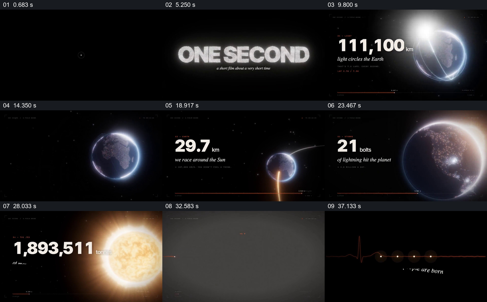

# 用同一秒钟连接宇宙尺度与人体尺度

- 作品：案例 064（库内案例）。
- 原片范围：00:00–41.000 秒；[原片](../video.mp4)｜[片段](c01.mp4)。含起点、不含终点。
- 观察方式：查看全片 64 格与本卡九宫格；未独立原速连续观看或听审，数据、产品宣称及迁移未核实。

## 原画面具体怎样设计

黑底从极小光点、计时与粒子引出白色大标题“ONE SECOND”。随后地球位于右侧，光迹环绕它，左侧白色大数字和 km 单位不断变化，旁边说明光绕地球；同一地球缩小，轨道和另一组数字呈现地球绕太阳的距离；地球重新放大后显示闪电及次数。底部细红线和小标记保持类似计时工具的视觉语言。

观察位置再转到发光太阳，左侧大数字显示物质变化量；强光之后画面转黑，只留红色心电线，一次心跳后线上出现多个小光点和“people are born”。末尾回到小点与“所有这些，每一秒”文字，随后重新显示 ONE SECOND 标题。取样画面只能看到数值和状态变化，不能认定视觉演示按真实一秒播放。

## 为什么这样设计，好在哪里

统一的“一秒”使原本尺度相差极大的现象可以在一个问题下依次理解；地球先承接光、轨道与闪电，再转到太阳及身体，减少每个例子都从零建立背景的负担。数字旁边保留对象和单位，既提供量级，也防止漂亮的宇宙画面失去解释对象。闪电、太阳物质、出生等可能依赖平均口径，片中数字和科学主张未独立核查。

## 可直接使用的创意指令

先选一个共同时间尺度和可核实的统计口径，给每个现象准备明确单位、条件和来源；从易于识别的共同对象开始，让相邻例子共享对象或空间，再将观察位置转换到其他尺度，最后回扣同一时间问题。数字变化和运动可作为示意，但应区分平均值、估计值和真实事件速度，避免动画时间造成误读。
